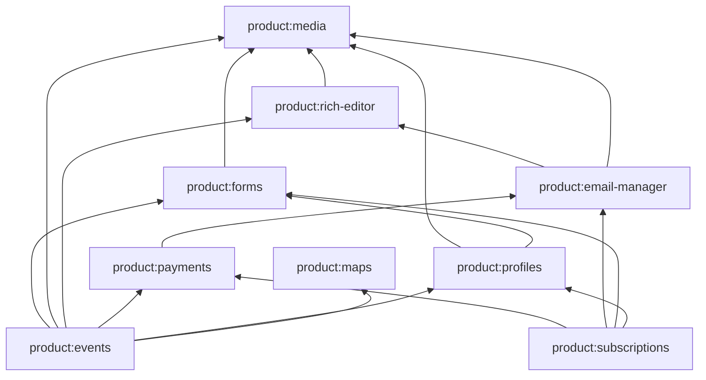

# Starforge architecture audit — Phase 2 (dependency and modularity)

**Date:** 2026-11-14  
**Method:** import and manifest inspection of this checkout. Phase 1 was a starting map only. Every finding below was re-checked against source. No code was changed.

**Verdict:** Starforge is a **modular monolith**. It has a real catalog, a `requires` closer, runtime on/off gates, and a few public doors. It is not a set of independently buildable, independently removable modules. Disabled packs stay in the Next.js graph. Several base packs call advanced packs. Events and Maps form a cycle. Hero code has nowhere to plug in except in-process maps and a jsonb bag.

---

## 1. Actual dependency graph

Two graphs exist. They are not the same.

### 1.1 Declared graph (`requires` on manifests)

Resolved by `closeModuleRequires` in `src/core/modules/requires-graph.ts`. Used at `modules:generate` and when Site Settings saves toggles.

Particles: `form` → forms; `search` → `product:search`; `map` and `live-map` → maps; each `event-*` particle → events.

No `requires`: redirects, consent, pwa, lexical-editor, notice-bar, search product, marketplace stub. Maps sets `requires: []` in `src/modules/maps/manifest.ts`.

### 1.2 Import graph (what the TypeScript actually loads)

Edges below are `from '@/modules/…'` or `import('@/modules/…')` **between pack folders**. App routes and Core that reach into packs are listed after the pack graph. “Door” means `api.ts` or `api.server.ts`. Anything else is an internal file.

| From | To | Kind | Door? | On `requires`? |
| --- | --- | --- | --- | --- |
| rich-editor | media `api` | static | yes | yes |
| email-manager | media `api`, rich-editor `api` / `api.server` | static | yes | yes |
| email-manager | forms (no import) | — | — | — |
| forms `email-notify.ts` | email-manager `api` + `api.server` + `forms-starters` | dynamic | mixed | **no** |
| forms `actions.ts` | events `form-hooks` | dynamic | no | **no, and wrong direction** |
| payments `email.ts` | email-manager `api.server` | dynamic | yes | yes |
| payments `entitlement.ts` | subscriptions `api` | dynamic | yes | **no, wrong direction** |
| profiles | media `api` / `api.server` / `image-frame` | static | partial | media yes |
| profiles | forms `api` | static | yes | yes |
| profiles `ProfileEditor.tsx` | maps `VenueLocationMap` | static | no | **no** |
| maps admin + `seed-from-event.ts` + `index.ts` | events `store`, `registrations`, `tiers`, `user-options`, `public/path` | static and dynamic | no | **no, wrong direction** |
| maps `maps-room-editor.tsx` | media `api` | static | yes | **no** |
| events | forms `api` and `presets` | static | `presets` is not the door | yes (forms) |
| events | media `api`, rich-editor `api` / `api.server` | static | yes | yes |
| events | payments `api` | static and dynamic | yes | yes |
| events | profiles `api.server` | static | yes | yes |
| events | maps `MapView`, `VenueLocationMap`, `public/EventLiveMap` | static | no | yes (maps) |
| events | email-manager `api.server` and `store` | dynamic | `store` is internal | **no** |
| events | form `FormWidget` | static | particle, not forms door | form particle not on events `requires` |
| subscriptions | payments `api` | dynamic | yes | yes |
| subscriptions | forms `api`, form `FormWidget` | static | mixed | forms yes; particle no |
| subscriptions | profiles `api.server` | static | yes | yes |
| subscriptions `email-starters.ts` | email-manager `store` | dynamic | no | email yes, file is internal |
| pwa settings form | media `api` | static | yes | **no** |
| form particle | forms `config`, `definition`, `definitions-store`, `actions`, `evaluate`, `rows`, … | static | no | requires forms, bypasses `api.ts` |

**App and Core edges into packs** (always part of the Next graph, not a manifest edge):

| From | To |
| --- | --- |
| `src/instrumentation.ts` | events `abandoned-checkout`; subscriptions `api`; email-manager `api.server` |
| `src/core/mail/with-send-log.ts` | email-manager `send-log` |
| `src/core/auth/account-data.ts` | profiles `api.server` and `store` |
| `src/core/consent/cookie.ts`, `types.ts` | `@starforge/module-consent` |
| `src/app/(frontend)/layout.tsx`, `src/app/(payload)/layout.tsx` | rich-editor CSS |
| `src/app/(frontend)/admin/forms/**` | forms internals; events `registration-form`; profiles `profile-form` |
| `src/app/(frontend)/admin/layouts/**`, breakpoints panels | media `api`, forms internals, events particle configs |
| `src/app/(frontend)/admin/users/**` | profiles `store`, `actions`, `form`, editor |
| `src/app/(frontend)/(public)/[locale]/events/**` | events internals and maps `EventLiveMap` |
| `src/app/(frontend)/(public)/[locale]/account/**` | profiles `store`, subscriptions `store` |
| `src/app/(frontend)/(public)/[locale]/checkout/**` | payments `api` and `public/CheckoutHandoff` |
| `src/app/(frontend)/manifest.webmanifest/route.ts` | pwa `build-webmanifest` |
| `src/app/api/payments/[provider]/webhook/route.ts` | payments `store` |
| `src/app/api/maps/live/**` | maps `store`, `channels` |
| `src/app/api/realtime/route.ts` | maps `realtime-acl` |
| `src/app/api/events/**`, `src/app/api/redirects/lookup/route.ts` | events / redirects internals or `api` |

`src/core/**` has no static `from '@/modules/…'` except `src/core/consent/*` → the consent package. Other Core reaches are dynamic (`account-data`, `with-send-log`).

`product:media` does not import another pack. Redirects, consent, search, lexical-editor, notice-bar, and marketplace do not import other packs (notice-bar and consent re-export their packages).

---

## 2. Circular dependency findings

### C1 — Events ↔ Maps — Critical

Both directions are source imports, not just a shared table.

Events → Maps (static):

- `src/modules/events/public/EventVenueMap.tsx` → `@/modules/maps/MapView`
- `src/modules/events/public/EventsMapPanel.tsx` → `@/modules/maps/MapView`
- `src/modules/events/admin/venues-manager.tsx` → `@/modules/maps/VenueLocationMap`
- `src/app/(frontend)/(public)/[locale]/events/[slug]/page.tsx` → `@/modules/maps/public/EventLiveMap`

Maps → Events:

- `src/modules/maps/admin/MapsLiveRoomsPage.tsx` → `@/modules/events/store`
- `src/modules/maps/admin/MapsLiveRoomEditPage.tsx` → `@/modules/events/store`, `user-options`
- `src/modules/maps/seed-from-event.ts` → `@/modules/events/registrations`, `tiers`
- `src/modules/maps/index.ts` → dynamic `@/modules/events/store` and `public/path` when the map particle shows venue pins

Manifests only record Events → Maps (`src/modules/events/manifest.ts`). Maps declares `requires: []`.

The cycle is across files, not a single top-level `import` loop through `maps/index.ts` (that file imports Events only inside `render`). The admin and seed files are top-level static imports. Deleting either pack breaks the other at compile time.

**Long-term:** Maps cannot ship as a venue-pin library for a site without Events, and Events cannot ship without Maps, even for a text-only event list. Changes to event store shape break TacMap admin. Changes to `MapView` break the event page.

**Direction:** Maps exposes markers and a pin picker through its door and accepts markers from the caller. Events (or a layout particle owned by Events) supplies venue markers. Maps admin does not import `events/store`.

### C2 — Forms ↔ Events — High

- `src/modules/forms/actions.ts` (around the submit success path) dynamically imports `@/modules/events/form-hooks` and calls `ensureEventsFormHooks()`.
- `src/modules/events/form-hooks.ts` statically imports `registerFormPreset` from `@/modules/forms/api`.

The import is inside a try/catch (“Events pack may be off the allowlist”). It still makes the Forms engine name an advanced pack. The preset registry was built so Events would call `registerFormPreset` from Events’ own boot, not from Forms’ submit action.

**Long-term:** Every Forms submit pays an Events import attempt. A future second consumer (Subscriptions already has its own registration form) will either be forgotten or will be hard-coded next to the Events import. Forms cannot be extracted while this call site exists.

**Direction:** Consumers register presets from their own instrumentation or a generated boot list. Forms only runs `runFormPresetOnSubmitted`.

No other pack cycle showed up at file level. Payments → Subscriptions is one-way and dynamic (`entitlement.ts`). Subscriptions → Payments is dynamic through `payment-bridge.ts` / `store.ts`. Those two files do not statically import each other, so Node can load them. It is still a layer cycle (C3 below), not a second init deadlock.

---

## 3. Hidden dependency findings

“Hidden” means the import exists and `requires` does not list it, or the import crosses a layer the manifest graph forbids.

| ID | Severity | Edge | Evidence |
| --- | --- | --- | --- |
| H1 | High | forms → email-manager | `src/modules/forms/email-notify.ts` imports `api`, `api.server`, and `forms-starters`. Forms manifest `requires` is only `product:media`. |
| H2 | High | events → email-manager | `src/modules/events/registrations.ts`, `email-emit.ts`, `actions.ts` (`store` and `api.server`), `admin/EventsRegistrantsPage.tsx`. Events `requires` omits email-manager. |
| H3 | High | maps → events | Files in C1. Maps `requires` is empty. |
| H4 | High | payments → subscriptions | `src/modules/payments/entitlement.ts` `hasCollectCapability` imports `hasEntitlement` when the subscriptions toggle is on. Payments `requires` is only email-manager. |
| H5 | Medium | profiles → maps | `src/modules/profiles/components/ProfileEditor.tsx` imports `VenueLocationMap`. Profiles `requires` is media + forms. `VenueLocationMap.tsx` itself does not import Events; it is a Leaflet pin picker. |
| H6 | Medium | maps → media | `src/modules/maps/admin/maps-room-editor.tsx` imports `MediaPicker`. |
| H7 | Low | pwa → media | `src/modules/pwa/admin/pwa-settings-form.tsx` imports `MediaPicker`. Pwa manifest has no `requires`. |
| H8 | Medium | events → `product:forms` preset module, not only `api` | `src/modules/events/registration-form-resolve.ts` imports `DEFAULT_EVENT_REGISTRATION_FORM_ID` from `@/modules/forms/presets`. |
| H9 | Medium | subscriptions and events → form particle | `SubscriptionIntakeForm.tsx`, `EventRegistrationForm.tsx` import `@/modules/form/FormWidget`. The particle is a separate manifest id. |
| H10 | High | Core and App bypass doors | See §1.2. Notable: webhook uses `payments/store`; account export uses `profiles/store`; users admin uses `profiles/store`. |

**Unnecessary hard edges**

- Payments’ manifest **requires** Email Manager, but `src/modules/payments/email.ts` already soft-fails when the import or the toggle fails. The hard `requires` forces Email Manager on for every Payments install, including a site that never sends commerce mail. Severity: Medium.
- Profiles → Maps is a widget choice. The profile record does not need TacMap rooms. Severity: Medium (undeclared), not a domain requirement.
- Forms → Email is a real product behavior (success mail) and is documented as the only mail path. It is necessary behavior with a missing declaration. Severity stays High because the graph lies, not because the mail call is wasteful.

**Shared mutable state (hidden coupling)**

| State | Where | Who writes it |
| --- | --- | --- |
| `registrations` Map | `src/modules/forms/preset-registry.ts` | `registerFormPreset` replaces the whole entry for an id |
| `hooks` Map | `src/modules/payments/consumer-hooks.ts` | `registerPaymentConsumerHook` replaces the handler for a key |
| Job handler map | `src/core/jobs` | Events abandoned-checkout, Events reminder, Subscriptions expiry, Email broadcast drain |
| Drizzle pool + Payload | `src/core/db`, `src/payload.config.ts` | Every pack |
| Site Settings global + `sf_site_chrome` + `sf_module_settings` | Payload global and Core tables | Toggles and per-module JSON |
| `sf_forms` / `sf_form_submissions` / `sf_form_settings` | **`src/core/db/schema.ts`**, not a forms schema file | Forms engine |

There is one Node process and one Postgres. Packs do not have private databases or private processes.

---

## 4. Module isolation assessment

Runtime toggles and build inclusion are different mechanisms. Isolation holds for the first and fails for the second.

### What a toggle actually does

`isCatalogModuleEnabled` (`src/core/settings/module-toggles.ts`) is checked on many admin pages and public event routes. Examples that return not-found or skip work when off:

- `src/app/(frontend)/(public)/[locale]/events/page.tsx`
- `src/modules/events/actions.ts`, `maps/actions.ts`, `profiles/actions.ts`, `subscriptions/actions.ts`, `email-manager/actions.ts`, `pwa/actions.ts`
- `src/app/(frontend)/manifest.webmanifest/route.ts` returns 404 when PWA is off
- Layout particles in `src/core/modules/SlotRenderer.tsx` return null for forms, search, and events when off
- Dashboard cards stay mounted with `moduleEnabled: false` (`src/core/dashboard/resolve.ts`)

`REQUIRED_MODULE_IDS` locks `platform:better-auth`, `product:media`, and `page-content` on. Turning those off is ignored.

Toggle closure (`resolveModuleToggleRequires`) refuses to turn off a module that an enabled module `requires`. It does **not** know about H1–H7. You can turn Email Manager off while Events stays on. Events then skips mail (`isEmailManagerEnabled`) or, for the registrant broadcast action, returns an error string. You can turn Events off while Maps stays on. Maps admin pages still import the Events store; the page module is still in the bundle. Actions check the Maps toggle, not “Events code absent.”

### Routes and services when “disabled”

| Surface | Still registered when the toggle is off? |
| --- | --- |
| Generated admin shims under `src/app/(frontend)/admin/(modules)/` | Yes, as long as the id is on the allowlist. The page file exists. The page function usually checks the toggle and bails. |
| Hand-written public routes (`events`, `account/profile`, `checkout`, `search`, `u/[handle]`) | Yes. They are normal App Router files. |
| Hand-written API routes (`/api/events`, `/api/maps/live`, `/api/payments/.../webhook`, `/api/redirects/lookup`, `/manifest.webmanifest`) | Yes. |
| Proxy hook | `runProxyHooks` still loads allowlisted handlers (`src/generated/module-registry.server.ts` imports `@/modules/redirects/proxy`). Toggle must be enforced inside the handler if at all. |
| Boot jobs | `src/instrumentation.ts` always imports Events `ensureAbandonedCheckoutSweep`. Subscriptions and Email broadcast registration are try/caught, not toggle-checked before import. |

So a disabled module still **registers** its routes. It usually **refuses** the request after the module has already been loaded.

### Global init side effects

`src/instrumentation.ts` `register()`:

1. `assertStarforgeEnvAtBoot()`
2. Unconditional `import('./modules/events/abandoned-checkout')` then `ensureAbandonedCheckoutSweep()`
3. `import('./modules/subscriptions/api')` then payment hook + expiry job
4. `import('./modules/email-manager/api.server')` then broadcast drain

Events boot is not wrapped in try/catch. A checkout that omits Events still fails boot if this file is unchanged, because the path is literal.

Forms submit (`src/modules/forms/actions.ts`) attempts to load Events hooks on every successful submit.

### Can removing a module break unrelated functionality?

Yes.

- Delete `src/modules/events` and Maps admin, the map particle, Forms’ submit import, the public `/events` routes, and `instrumentation.ts` fail to compile.
- Delete `src/modules/maps` and Events venue UI, the public event page (`EventLiveMap`), and Profiles’ editor fail to compile.
- Delete `src/modules/email-manager` and Forms notify, Payments mail, Events mail, Core `with-send-log`, and instrumentation fail at runtime (most are caught) or, for static CSS/layout, not at all. Events’ broadcast action imports it only when invoked.
- Delete `src/modules/profiles` and Core account download (`account-data.ts`) degrades (caught). Users admin and account pages do not.
- `sf_forms` lives in the Core schema. Removing the Forms folder does not remove the tables, and Core migrations still own them.

**Isolation score:** runtime behavior is gated often enough to hide UI. Code, routes, and boot are not isolated.

---

## 5. Base module independence assessment

The layer rule says a base pack may `require` another base pack, and must not depend on an advanced pack. “Depends only on Core” is **false** for every base pack except Media’s pack folder.

| Base pack | Depends only on Core? | Can it be maintained without other packs? | Evidence |
| --- | --- | --- | --- |
| `product:media` | The folder does not import other packs. Storage, pipeline, and Payload `media` live in `src/core/media` and `src/collections/Media.ts`. | Yes, relative to other products. It is not optional (`required: true`) and not removable from the build. | No `@/modules` imports under `src/modules/media` except its own manifest strings. |
| `product:rich-editor` | No. Requires Media. | Yes, given Media. | `SfHtmlField.tsx` → `MediaPicker`. |
| `product:email-manager` | No. Requires rich-editor and media. Does not import Events, Forms, or Payments. `forms-starters.ts` only stores template rows keyed for Forms; it does not import Forms. | Yes, given its two `requires`. | Admin and `store.ts` use the rich-editor door. |
| `product:payments` | No. Requires Email Manager. Also calls Subscriptions when that toggle is on. | No. Collect capability is split with an advanced pack. | `entitlement.ts`. |
| `product:forms` | No. Requires Media. Also calls Email Manager and Events. Tables are in Core schema. Admin UI is hand-written in `src/app`, not a generated shim. | No. | `email-notify.ts`, `actions.ts`, `src/core/db/schema.ts` `sfForms`. |
| `product:profiles` | No. Requires Media and Forms. Also renders Maps’ pin picker. `getPersonas` is written to work when the toggle is off (fallback persona). The **code** still has to be present. | Mostly, if the Maps import were optional. | `api.server.ts` documents the fallback. `ProfileEditor.tsx` does not make Maps optional at compile time. |
| `product:maps` | No. `requires: []` is inaccurate. Imports Events and Media. | No. TacMap admin is an Events client. | C1, H3, H6. |

Base packs share Core singletons (db, settings, jobs, mailer). That is acceptable for a monolith host. The independence failure is the advanced-pack imports and the shared Forms tables inside Core’s schema file.

---

## 6. Advanced module dependency assessment

| Pack | Unrelated packs it still touches | Can it run without those? |
| --- | --- | --- |
| `product:events` | Declared: forms, media, rich-editor, payments, profiles, maps. Undeclared: email-manager, form particle. | Mail paths are dynamic and usually check `isEmailManagerEnabled` or catch. Maps and Payments are compile-time or boot-time requirements. Events cannot be built without Maps. |
| `product:subscriptions` | Stays inside payments, email, forms, profiles, and the form particle. Does not import Events or Maps. | Yes. This is the cleanest advanced pack. Email starters import `email-manager/store` (internal) rather than only `api.server`. |
| `product:marketplace` | Nothing. Dashboard stub, no schema, `defaultEnabled: true` on the core allowlist. | Yes, because it does nothing. It still occupies a catalog row and a dashboard loader (`src/generated/module-registry.server.ts`). |

Events is not an independent product on top of stable engines. It is intertwined with Maps and pulled into Forms’ submit path. Subscriptions matches the intended shape: it calls doors (`payments/api`, `forms/api`, `profiles/api.server`) and registers a payment hook from its own module (`payment-bridge.ts`, started from `instrumentation.ts`).

Advanced packs cannot be enabled “alone” in the toggle UI. `resolveModuleToggleRequires` turns their `requires` on. That part is correct for the declared graph and blind to hidden edges.

---

## 7. Module contract assessment

### Doors that exist

| Pack | Documented door | Stable enough to recode behind? |
| --- | --- | --- |
| media | `src/modules/media/api.ts`, `api.server.ts` | Only if callers stop using `image-frame` directly (`profiles/store.ts`, `form.ts`, `privacy.ts`, `types.ts`). |
| forms | `src/modules/forms/api.ts` | The comment says Events, Profiles, and Payments import this file only. Payments does not import Forms. The form particle and Forms admin import internals (`config`, `definition`, `definitions-store`, `actions`, `rows`, `presets`). Replacing the engine means editing those callers. |
| payments | `src/modules/payments/api.ts` | Events and Subscriptions mostly use it. The webhook route imports `store` directly (`src/app/api/payments/[provider]/webhook/route.ts`). `registerPaymentConsumerHook` is a real extension point. One handler per string key. |
| profiles | `src/modules/profiles/api.server.ts` | `getPersonas` is a real contract and degrades when the toggle is off. Account pages, users admin, and `account-data.ts` also import `store`, `actions`, and `form`. |
| email-manager | `api.ts`, `api.server.ts` (`emitEmailTrigger`) | Payments and Forms use the door. Events settings seed and Subscriptions starters import `store`. |
| rich-editor | `api.ts`, `api.server.ts` | Callers found in Events and Email use the door. |
| redirects | `src/modules/redirects/api.ts` | Lookup route uses it. Proxy uses the generated handler path, not the door. |
| maps, events, pwa | No equivalent door | Callers import `MapView`, `store`, `public/*`, `build-webmanifest`. |

Communication styles in the same codebase:

1. Manifest `requires` plus a door import (Subscriptions → Payments). Consistent.
2. In-process registry (form presets, payment hooks, job handlers). Consistent mechanism, inconsistent registration site (Forms pulls Events; instrumentation pulls Subscriptions).
3. Direct file imports of stores and React widgets. Common, and it freezes internal file layout.

`defineStarforgeModule` versions (`version: '0.1.0'` and similar) are not compared. `closeModuleRequires` checks that a required **id** exists. It does not check semver, peer ranges, or API shape. The only version strings that affect install are `registryPackages` for notice-bar and consent (`scripts/lib/module-allowlist.mts`), and those are exact package versions for npm, not compatibility between Starforge packs.

Replacing an implementation without editing dependents is realistic for:

- Core ports that already have a factory (mailer, cache, map provider, payment provider, page reads).
- `emitEmailTrigger` and `registerPaymentConsumerHook`, if callers stay on those functions.

It is not realistic for Maps, Events UI, or the Forms engine, because dependents name internal files.

---

## 8. Hero extension assessment

There is no Hero loader, no `src/hero`, and no second skin beside `src/core/skin/skins/starforge-pastel`.

What can change behavior without editing a pack’s source:

| Mechanism | Explicit? | Multiple contributors? | Conflict behavior | Isolated? |
| --- | --- | --- | --- | --- |
| Layout particles and atoms via manifests | Yes (`defineStarforgeModule`) | Yes, many slots on one outline | Two particles can be placed; they do not negotiate. Last layout save wins per slot. | A particle’s code can still import any pack (the map particle imports Events). |
| `publicShell`, proxy hooks, admin dashboard widgets | Yes, codegen | Yes, ordered lists | Proxy `order` is the only priority. No conflict detection. | Same as any in-repo import. |
| `registerFormPreset` | Yes, function on the Forms door | One registration per id | `registrations.set` replaces label, seeds, messages, and `onSubmitted` (`preset-registry.ts`) | The registry is process-global. A second pack that uses `event-registration` overwrites Events. |
| `registerPaymentConsumerHook` | Yes | One function per key | `hooks.set` replaces (`consumer-hooks.ts`) | Keys are global strings. Events uses `events.confirmRegistration`; Subscriptions uses `subscriptions.activate`. A second listener on the same key cannot coexist. |
| `registerJobHandler` | Yes, Core | One handler per job name | Later register replaces | Same process. |
| `sf_profiles.extensions` jsonb | Column only | A single JSON object | Last writer to the row wins | `src/modules/profiles/fields.ts` says Hero adds vertical fields through this seam. `ProfileFieldKey` is a closed union. Nothing in `src/` registers a Hero field, validator, or editor against that object. The column is stored and copied (`profiles/store.ts`). It is not an extension API. |

A Hero cannot today:

- add an event field, a fee table, or a theme pack without editing `src/modules/events` or `src/core/skin`
- wrap a module (middleware chain) 
- coexist with another Hero on the same preset id or the same payment hook key

Conflicts are silent replacement, not a detected error.

---

## 9. Build-time modularity assessment

`npm run modules:generate` (`scripts/generate-module-registry.mts`):

- Rejects unknown allowlist ids.
- Rejects duplicate manifest ids.
- Runs `closeModuleRequires` and pulls missing `requires` into the allowlist.
- Emits dynamic `import()` loaders only for allowlisted particles, shells, proxy hooks, dashboard widgets, and message JSON.
- Rewrites shims in `src/app/(frontend)/admin/(modules)/`.

That is reliable **for the generated surface**. It does not scan imports. An undeclared edge never fails generate.

`starforge.modules.json` flavor `"core"` allowlists every current pack, including the marketplace stub. `modules:sync` only adds or removes `@starforge/module-notice-bar` and `@starforge/module-consent`. Forms, Media, Payments, Maps, Events, and the rest are source files. They are in the TypeScript program (`tsconfig.json` includes `**/*.ts`). `next.config.ts` always applies `withPayload` and `withSerwist`.

Hand-written routes are not generated from the allowlist. A production `next build` of this tree compiles Events, Maps, Payments, Profiles, and PWA because pages and `instrumentation.ts` import them. Turning a toggle off does not drop the module from the server bundle. Omitting an id from `presets.core` drops its generated shim and its particle loader, and leaves the public `/events` page importing Events anyway.

Schema build is one Drizzle journal, `0000_baseline` through `0040_event_series`, globbing `src/modules/*/schema.ts` (`drizzle.config.ts`). Module tables and Core tables share `src/core/db/migrations`. There is no per-module migration stream. The runtime Drizzle client still loads only `src/core/db/schema.ts` (`src/core/db/index.ts`); module code passes its own table objects into that client.

Missing dependencies:

- Unknown `requires` ids throw at generate time.
- A missing folder on a **dynamic** import is often swallowed (`forms/actions.ts`, `payments/email.ts`, `payments/entitlement.ts`, `account-data.ts`, `with-send-log.ts`).
- A missing folder on a **static** import fails the build (Maps admin → Events store, Events page → Maps, Profiles editor → Maps).

Incompatible versions are not detected. Manifest `version` is unused by the resolver.

Dependency validation before initialization is the generate-time id check plus the toggle closer. There is no import lint that `requires` matches `from '@/modules'`. Boot does not verify the graph. It imports Events by path.

---

## 10. Prioritized architectural problems

### Critical

**P1. The production build is one application, not a set of optional modules.**  
Severity: Critical.  
Files: `src/instrumentation.ts`; `src/app/(frontend)/(public)/[locale]/events/**`; `src/app/(frontend)/(public)/[locale]/account/**`; `src/app/(frontend)/(public)/[locale]/checkout/**`; `src/app/api/events/**`; `src/app/api/maps/**`; `src/app/api/payments/**`; `next.config.ts`; `src/modules/manifest-index.ts` (eager manifest imports).  
Evidence: allowlist codegen only omits generated loaders and `(modules)` shims. Public routes and boot import packs by path. `withPayload` / `withSerwist` always wrap Next.  
Consequence: a site that “doesn’t use Events” still ships Events. You cannot drop a pack from disk without editing the host. Scale-out is “scale the whole Node app,” which is fine, but team and variant scale (several products from one core) is blocked.  
Direction: host routes and boot must be generated from the allowlist the same way admin shims are. Packs not on the allowlist must have zero static imports from `src/app` and `src/instrumentation.ts`.

**P2. Events and Maps are a cycle.**  
Severity: Critical.  
Files: listed in C1.  
Evidence: static imports both ways; Maps `requires: []`.  
Consequence: neither pack can evolve, test, or ship alone. A Maps bugfix build pulls Events and the reverse.  
Direction: break the cycle. Maps renders markers it is given. Events owns “pins for these venues” and the live-map embedding. Maps admin does not read `events/store`.

### High

**P3. Base packs call advanced packs.**  
Severity: High.  
Files: `src/modules/forms/actions.ts` (Events); `src/modules/maps/**` (Events); `src/modules/payments/entitlement.ts` (Subscriptions).  
Evidence: dynamic imports, two of them gated, none declared as `requires` (and `requires` would invert the layer if added).  
Consequence: the base layer is not a stable platform. Extracting Forms or Payments takes Events and Subscriptions with it. New advanced packs get special-cased inside base code.  
Direction: base code exposes registries. Advanced packs register themselves from their own boot entry, which the host loads only when that pack is installed.

**P4. Declared dependencies do not match imports.**  
Severity: High.  
Files: forms `email-notify.ts`; events mail files; maps Events imports; profiles `ProfileEditor.tsx`; maps `maps-room-editor.tsx`; pwa settings form.  
Evidence: table in §3. `closeModuleRequires` never reads these imports.  
Consequence: toggle closure and generate-time closure protect the wrong graph. Operators can disable Email Manager while Events and Forms still call it. A future allowlist that trusts `requires` will omit packs the compiler still needs.  
Direction: one mechanical check — every `@/modules/<other>` import must be the other pack’s door, and the other id must be in `requires` or in an explicit `optionalRequires` that is still validated when the import is static.

**P5. Internal files are the real API.**  
Severity: High.  
Files: `src/modules/form/index.ts`, `FormWidget.tsx`; `src/modules/profiles/store.ts` (`image-frame`); `src/app/api/payments/[provider]/webhook/route.ts`; `src/core/auth/account-data.ts`; `src/modules/events/actions.ts` email `store` import; `src/modules/subscriptions/email-starters.ts`.  
Evidence: doors exist and are documented in file headers, then bypassed.  
Consequence: renaming an internal file is a cross-pack break. A second implementation cannot be swapped behind `api.ts`.  
Direction: app routes and other packs import doors only. Webhook, account export, and email seed move behind those doors. Lint the boundary.

**P6. Schema and migrations are a single coupled history.**  
Severity: High.  
Files: `drizzle.config.ts`; `src/core/db/schema.ts` (`sfForms`, `sfFormSubmissions`, `sfFormSettings`, `sfMediaSettings`); `src/core/db/migrations/0000_baseline.sql` through `0040_event_series.sql`; `src/modules/*/schema.ts`.  
Evidence: one drizzle-kit out directory. Forms tables are declared in the Core schema file even though the engine lives in `src/modules/forms`.  
Consequence: a module cannot be installed as an additive migration package or removed without editing the shared journal. “Independent module” is not true at the database boundary.  
Direction: each pack owns its tables and its migration slice. Core schema stops declaring Forms and media-settings tables. The host runs pack migrations in dependency order.

**P7. Boot side effects ignore the installer.**  
Severity: High.  
File: `src/instrumentation.ts`.  
Evidence: literal `import('./modules/events/abandoned-checkout')` with no allowlist check and no try/catch. Subscriptions and email are try/caught only.  
Consequence: the host does not boot without the Events tree. Job registration is global and unconditional for that sweep.  
Direction: generated boot list of `bootImportPath` from allowlisted manifests. No literal pack paths in the host file.

### Medium

**P8. Extension registries are single-slot and process-global.**  
Severity: Medium.  
Files: `src/modules/forms/preset-registry.ts`; `src/modules/payments/consumer-hooks.ts`; `src/core/jobs`.  
Evidence: `Map.set` replaces. No subscriber list, no Hero id, no conflict error.  
Consequence: two Heroes or two packs cannot both handle `event-registration` or the same payment key. The second registration wins with no log. Serverless or multi-instance boots each have their own map; that is safe only because registration is in-process and idempotent, and unsafe if registration is forgotten on a cold start (Forms currently re-registers Events on submit; Subscriptions depends on instrumentation).  
Direction: multicast hooks (list of handlers) or reject a second registration. Registration runs from the generated boot list on every process start.

**P9. Hero has a column and a comment, not an extension point.**  
Severity: Medium.  
Files: `src/modules/profiles/schema.ts` (`extensions`); `src/modules/profiles/fields.ts`; `src/modules/profiles/store.ts`. No `src/hero`.  
Evidence: `ProfileFieldKey` is closed. No contributor registry. Skin port has one pack, `starforge-pastel`.  
Consequence: ASN (or any second brand) will fork module source. The jsonb bag can store data and cannot add UI, validation, or admin.  
Direction: a Hero manifest the host loads after modules: field contributions, theme pack, and hook subscriptions. Modules read contributions; they do not import Hero.

**P10. No compatibility or contract version check.**  
Severity: Medium.  
Files: `src/core/modules/define-module.ts` (`version` field); `src/core/modules/requires-graph.ts`; each `manifest.ts`.  
Evidence: versions are strings. The resolver checks ids only.  
Consequence: a pack can `require` another id whose door has changed shape. The failure appears as a TypeScript error or a runtime exception, not as an installer error.  
Direction: peer range on `requires` (`product:payments: ^0.1`) enforced at generate time against the required manifest’s `version`, plus a small exported contract version on each door.

**P11. Email is both a hard requirement and an undeclared optional.**  
Severity: Medium.  
Files: `src/modules/payments/manifest.ts` versus `payments/email.ts`; Forms and Events mail files with no `requires`.  
Evidence: Payments cannot be toggled on without Email Manager. Forms and Events call Email Manager anyway when Payments’ rule does not apply.  
Consequence: the graph over-constrains Payments and under-constrains Forms and Events.  
Direction: one `optionalRequires` (or a soft integration list) for mail, used by Payments, Forms, and Events, with static imports forbidden unless the edge is required.

### Low

**P12. Placeholder catalog rows look like products.**  
Severity: Low.  
Files: `src/core/modules/host-manifests.ts` (`product:posts`); `src/modules/marketplace/manifest.ts`; `src/core/settings/module-toggles.ts`.  
Evidence: Posts is a feature flag with no collection. Marketplace is a dashboard widget and is `defaultEnabled: true` on the core flavor.  
Consequence: operators and later audits treat stubs as shipped subsystems.  
Direction: stubs stay out of the default flavor, or their manifest `kind` and description stay visibly non-functional and default off.

**P13. Core features use `product:*` ids.**  
Severity: Low.  
File: `src/core/modules/host-manifests.ts` (`product:layout-manager`, `product:page-settings`, `product:primary-nav`, and the other host rows).  
Evidence: implementation is under `src/core`, not `src/modules`.  
Consequence: layer reviews keep mis-classifying the host as a set of removable products.  
Direction: host ids stay `platform:*`. Toggles may remain. They are not base modules.

---

## 11. Answers to the audit questions

| Question | Answer |
| --- | --- |
| Are base modules independent? | Media’s folder is. The others depend on sibling base packs. Forms, Maps, and Payments also depend on advanced packs. |
| Do they depend only on Core? | No. |
| Can advanced modules ignore unrelated modules? | Subscriptions can. Events cannot ignore Maps, and Forms does not ignore Events. |
| Hidden shared state? | Yes: preset map, payment-hook map, job map, one database, Forms tables inside the Core schema, one settings global. |
| Independent development? | Only behind a door that callers actually use. Events/Maps/Forms cannot be owned by separate lifecycles today. |
| Enable/disable independently? | Toggles hide UI and many actions. `requires` closure blocks turning off a declared dependency. Hidden edges are not enforced. |
| Do disabled modules register routes? | Yes. Route files stay. Handlers usually no-op or 404 after load. |
| Excluded from production builds? | No, for this flavor. Generated loaders can omit an id; hand-written routes and instrumentation cannot. |
| Global init side effects? | Yes. `instrumentation.ts` and the Forms submit path. |
| Can removal break unrelated code? | Yes. See §4. |
| Public interfaces defined? | For media, forms, payments, profiles, email, rich-editor, redirects. Inconsistently honored. |
| Encapsulated? | No. Stores and widgets are imported across pack boundaries. |
| Contracts stable / replaceable? | Core ports are. Pack doors are not, while internals leak. |
| Discovery reliable? | Manifest index plus allowlist is reliable for ids that were registered. It does not discover stray imports. |
| Resolution correct? | Correct for the declared graph. Incomplete for the import graph. |
| Transitive dependencies? | Yes, for `requires` only. |
| Missing dependencies detected? | Unknown ids at generate time. Static missing files at compile time. Dynamic missing files often ignored. |
| Incompatible versions? | Not handled. |
| Validation before init? | Generate-time id check only. Boot does not validate the graph. |
| Hero without editing module source? | No practical path beyond layout particles and a jsonb blob. |
| Multiple extensions? | Particles can coexist. Hook keys and preset ids cannot. |
| Extension conflicts? | Silent overwrite. |
| Extensions isolated? | No isolation boundary beyond “another folder under `src/`.” |

---

## 12. Overall assessment

Starforge is **not** genuinely modular in the sense of independently extensible, independently removable products. It **is** a well-structured modular monolith:

- One Next.js deployable, one Postgres, one Payload schema, one Drizzle migration history.
- A manifest catalog and a `requires` closer that correctly force declared base engines on when Events or Subscriptions is enabled.
- Runtime toggles that keep a lot of UI honest.
- A handful of real seams: payment consumer hooks, form preset registration, email triggers, `getPersonas`, media picker, Core ports.

The monolithic patterns that are still in force:

1. Packs are source folders on the application graph, not build units. The allowlist does not control public routes or boot.
2. Dependency truth is the import graph, and it contains a cycle (Events ↔ Maps) plus upward calls (Forms, Maps, Payments → advanced packs) that the manifest graph denies.
3. “Public API” files are optional conventions. Callers import stores, widgets, and preset constants.
4. Extension is in-process `Map.set`, last writer wins, and Hero has no loader.

That is enough structure to keep growing **inside this repository** if the cycles are cut and the host stops hard-coding pack paths. It is not enough structure to hand a second team a base engine, or to ship a Hero, without editing those engines’ source.

Treat Phase 1’s layer table as the **target**. Treat this document’s import table as the **system you have**.
