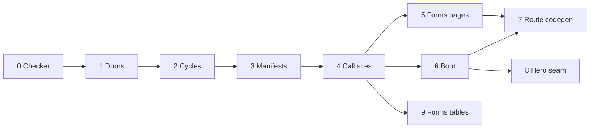

# Starforge architectural remediation plan

**Date:** 2026-11-14  
**Inputs:** `ARCHITECTURE_AUDIT_PHASE_1.md` (what exists), `ARCHITECTURE_AUDIT_PHASE_2.md` (where the import graph diverges from the manifests).  
**Constraint:** modular monolith stays one Next.js process, one Postgres database, one deploy. No microservices. No new framework. Existing checkout, admin, and public behavior stays unless a stage explicitly names a toggle change.

This plan is a sequence of corrections. It does not implement them.

---

## 1. Target rules

These rules are the acceptance bar. They match the layer model in Phase 1 and the import findings in Phase 2.

| From | May import | May not import |
| --- | --- | --- |
| Core (`src/core`, `src/proxy.ts`, `src/instrumentation.ts`) | `@/generated/*`, other Core, the two existing package entry points only through a generated loader | `@/modules/**` by literal path |
| Base pack | Core, another base pack’s **public entry**, and only if `requires` or `optionalRequires` names that id | Advanced packs, Hero, another pack’s `store`, `schema`, `actions`, or private components |
| Advanced pack | Core, base public entries it `requires` | Hero, a base pack’s internals, another advanced pack |
| Site pack (redirects, consent, search, pwa, lexical, notice-bar) | Core, base public entries it declares | Advanced packs |
| Hero | Core, module **public entries**, existing skin registry | Module internals. Nothing in `src/modules` or `src/core` may import `@/hero` |
| `src/app` route file | A generated shim, or a pack public page the shim re-exports | Another pack’s `store` or schema |

**Public entry** of a pack is only:

- `@/modules/<id>/api`
- `@/modules/<id>/api.server`
- `@/modules/<id>` when that file is the documented client barrel (`form`, `maps` widget barrel after Stage 1)
- Admin and public **pages owned by that pack**, reached through generated `page.tsx` shims

`product:forms` and the `form` particle are one family. The particle may import the forms engine. Every other pack uses `@/modules/forms/api` and `@/modules/form` (the widget), not `definitions-store`, `presets`, or `actions`.

**Base may require base.** That is the intended model (Phase 1). “Base depends only on Core” is not the target.

**One database, one migration journal.** Packs own their `pgTable` definitions. Drizzle Kit keeps a single `src/core/db/migrations` history. Splitting journals is optional and is not required to finish this plan.

**Runtime toggle is not build exclusion.** Both stay. A toggle hides behavior. The allowlist decides whether the pack is compiled in. Stage 7 is what makes the second sentence true. Until then, do not claim a pack can be deleted from disk.

---

## 2. Mandatory and optional

### Mandatory (this plan’s sequence)

| Stage | Closes audit items | Runtime behavior |
| --- | --- | --- |
| 0. Boundary checker | Stops new cycles while later stages land | Unchanged |
| 1. Widen public doors | P5 preparation | Unchanged (re-exports) |
| 2. Break cycles and upward calls | C1, C2, H3, H4 | Unchanged if boot/registries run |
| 3. Declare real edges | H1, H2, H5, H6, H7, H9 | Unchanged, except new `requires` that are already globally required (`product:media`) |
| 4. Point callers at doors | H8, H10, internal `store` imports | Unchanged |
| 5. Forms admin and seed ownership | Forms pages in `src/app` importing Events and Profiles | Unchanged |
| 6. Generated boot | `instrumentation.ts` literals, preset registration site | Unchanged |
| 7. Allowlist-owned routes | Build exclusion for omitted packs | Omitted pack’s URLs 404 because the shim was not generated. The core flavor allowlist stays complete, so the default site does not lose routes |
| 8. Hero seam | Extension overwrite, `extensions` jsonb with no reader | No hero configured means today’s UI |
| 9. Forms table ownership | `sf_forms*` declared in Core schema | Same tables, same SQL |

### Optional (do not block the sequence)

| Item | Why it is optional |
| --- | --- |
| O1. Change Payments’ hard `requires: ['product:email-manager']` into `optionalRequires` | Receipts are part of the product. The hard edge matches “mail is Email Manager.” `email.ts` already soft-fails if the toggle is off. Loosening the manifest lets a site enable Payments without Email Manager. That is a product decision, not a defect fix. |
| O2. Marketplace stub `defaultEnabled: false` and out of `presets.core` | Removes a misleading card. No domain behavior. |
| O3. Rename host catalog ids `product:layout-manager` and siblings to `platform:*` | True to Phase 1, high churn in settings JSON and ACL. Do not do it inside this remediation. |
| O4. Per-module Drizzle journals | Second migration runner. Real risk of split history on one database. Defer until a pack is published outside this repo. |
| O5. Register every module schema on the runtime Drizzle client | `src/core/db/index.ts` would import every pack schema. That points Core at modules. Packs already pass table objects. Leave it. |
| O6. Semver ranges on `requires` | Manifest `version` is unused. Id checks already exist. Add a range only when a second released version exists. |
| O7. Extract every pack into `@starforge/module-*` | Phase 1 records that only consent and notice-bar are packages. Moving the rest is a packaging program, not a dependency fix. |

### Explicit non-goals

- Microservices, message buses, or a database per module.
- A general dependency-injection container. The three registries that already exist (form presets, payment hooks, job handlers) grow one function each where a cycle requires it.
- Replacing Payload, Better Auth, or the layout canvas.
- Building ASN domain features, a second skin look, or Ads/Shop. Hero Stage 8 only adds the seam.
- Rewriting migrations `0000`–`0040`.
- Making Payload optional. Site Settings and media still call `getPayload()`. `withPayload` stays in `next.config.ts`.

---

## 3. Implementation sequence

Stages 2A, 2B, and 2C can ship as separate pulls after Stage 1. They do not depend on each other. Stages 5 and 6 must finish before Stage 7 deletes hand-written routes. Stage 9 waits until Stage 4 has stopped Events, Profiles, and Subscriptions from importing `sfForms` out of Core.



After every stage: `npm run test:unit` and the verify scripts named in that stage. Default flavor remains `core`. A developer can still open `/admin`, `/events`, checkout, and `/cms/admin`.

---

## Stage 0 — Boundary checker (mandatory)

**Reasoning.** Later edits will recreate the cycles unless CI sees them. Phase 2 showed `closeModuleRequires` only walks `requires`, so a green generate does not mean the import graph is legal.

**Affected**

- New `scripts/verify-module-boundaries.mts`
- New `scripts/module-boundary-allowlist.json` listing today’s known violations (the Phase 2 tables C1, C2, H1–H10)
- `package.json` script `verify:module-boundaries`, added to `verify:all`
- No application code

**Depends on.** Nothing.

**Migration**

1. Walk `src/**/*.{ts,tsx}` for `@/modules/<folder>` and `import('@/modules/<folder>')`.
2. Map folder → manifest id via `src/modules/manifest-index.ts`.
3. Fail when a new edge is a cycle, a base→advanced import, or an import of another pack that is not that pack’s public entry and not on the allowlist.
4. Seed the allowlist with the current edges so the script passes on today’s tree. Each later stage deletes the rows it fixes. The stage is not done while its rows remain.

**Regressions.** None at runtime. A too-strict first version can fail `verify:all` on comments or type-only imports. Type-only imports of a public type are allowed. Type-only imports of another pack’s internal types are violations.

**Acceptance**

- `npm run verify:module-boundaries` passes with the seeded allowlist and fails if a throwaway file under `src/modules/maps` imports `@/modules/events/store` and is not allowlisted.
- No change in `test:unit`.

---

## Stage 1 — Widen public doors (mandatory)

**Reasoning.** Call sites should move onto stable files before any cycle is cut. Re-exporting existing symbols does not add an abstraction. It names the contract the audit already found callers using.

**Affected**

| Pack | Add re-exports | Callers that will move in Stage 4 |
| --- | --- | --- |
| `src/modules/maps/api.ts` (new client barrel) | `MapView`, `VenueLocationMap`, `EventLiveMap` from their current files | Events public/admin, Profiles editor, event slug page |
| `src/modules/maps/api.server.ts` (new) | Room read/write functions `seed-from-event.ts` and live routes need, plus `registerEventCatalog` (empty registry, Stage 2A fills it) | Maps admin stays inside the pack; Events will call the register function |
| `src/modules/forms/api.ts` | Already exports `DEFAULT_EVENT_REGISTRATION_FORM_ID` and `registerFormPreset`. Add any preset id still imported from `presets.ts` by Events | `events/registration-form-resolve.ts` |
| `src/modules/email-manager/api.server.ts` | `seedEmailStarter({ template, rule })` implemented by the existing store functions `createEmailTemplate` / `createEmailRule` / updates | `events/actions.ts`, `subscriptions/email-starters.ts` |
| `src/modules/payments/api.ts` | `applyProviderPaymentResult`, `resolveProviderForProviderRef` if they are only on `store` today | `src/app/api/payments/[provider]/webhook/route.ts` |
| `src/modules/profiles/api.server.ts` | `exportOwnProfileRecord(userId)` returning the same fields `account-data.ts` builds | `src/core/auth/account-data.ts` |
| `src/modules/media/api.ts` and `api.server.ts` | `normalizeImageFrame`, `parseImageFrameJson`, `DEFAULT_IMAGE_FRAME`, `ImageFrame` | `profiles/store.ts`, `form.ts`, `privacy.ts`, `types.ts` |
| `src/modules/form/index.ts` | Stays the public client widget. No new wrapper | Events and Subscriptions keep importing `FormWidget` from here |

Do not move implementations in this stage. Do not delete the old files.

**Depends on.** Stage 0, so new files are classified as public entries in the checker.

**Migration**

1. Add the re-exports.
2. Mark those paths as public entries in the checker.
3. Leave every existing import in place.

**Regressions.** A client barrel that re-exports a server module will break the Next client graph. `MapView` and `VenueLocationMap` are client components. `api.server.ts` must not be imported by them. `exportOwnProfileRecord` stays in `api.server.ts` (`server-only`). Email seed stays server-only.

**Acceptance**

- Existing unit tests pass, including `src/modules/forms/*.test.ts`, `src/modules/events/registration-form-resolve.test.ts`, `src/modules/payments/checkout-expiry.test.ts`.
- `verify:maps-v1`, `verify:maps-live`, `verify:events-pr1`, `verify:email-manager`, `verify:profiles-v1` pass.
- No import site has been rewritten yet (`git diff` is re-exports and the checker’s public-entry list).

---

## Stage 2 — Break cycles and upward calls (mandatory)

Three pulls. Each preserves behavior by registering the same function from the pack that already owns it.

### 2A — Events ↔ Maps

**Reasoning.** Maps is base. Events is advanced and already `requires` Maps. The legal direction is Events → Maps. Maps must render markers it is given and must not read `events/store`.

**Affected**

- `src/modules/maps/index.ts` (stop importing `@/modules/events/store` and `public/path`)
- `src/modules/maps/admin/MapsLiveRoomsPage.tsx`
- `src/modules/maps/admin/MapsLiveRoomEditPage.tsx`
- `src/modules/maps/seed-from-event.ts` (move the orchestrator)
- `src/modules/maps/api.server.ts` (`registerEventCatalog`, `listEventCatalog`)
- `src/modules/events/particles/event-map-markers.ts` (new, small) or the existing map-related events public helpers
- Events boot call site: temporary `ensureEventsMapCatalog()` invoked from `src/instrumentation.ts` until Stage 6
- `src/modules/events/manifest.ts` unchanged (`requires` already lists maps)

**Registry shape** (one object, same style as `consumer-hooks.ts`):

```ts
type EventCatalog = {
  listPublishedVenues(): Promise<MapMarker[]>
  listEventsForAdmin(): Promise<Array<{ id: string; label: string }>>
  findEventForAdmin(id: string): Promise<{ id: string; label: string } | null>
  listRoster(eventId: string): Promise<RosterRow[]>
}
```

Maps admin and the map particle call `listEventCatalog()`. If nobody registered, the particle draws an empty map (today’s `catch` path) and the room editor hides the event picker instead of crashing.

`seed-from-event.ts` moves to Events. Events loads registrations and tiers, then calls a Maps door such as `replaceRoomRoster(roomId, rows)`. Maps writes `sf_map_*` only.

**Depends on.** Stage 1 client/server barrels.

**Migration**

1. Add the registry and the empty fallback.
2. Register the catalog from Events, called from `instrumentation.ts` inside the existing Node `register()` (try/catch, same as Subscriptions).
3. Switch Maps call sites to the registry.
4. Delete Maps’ imports of `@/modules/events/**`.
5. Remove those edges from the checker allowlist.

**Regressions**

- Map particle `showEventVenues` shows no pins if boot did not run (Edge runtime already returns before boot; the particle runs on the Node server, where `register()` runs).
- Room editor that assumed a live event list now shows an empty picker when Events is toggled off. That is the correct product result. When Events is on and boot ran, the list matches today’s `listEvents`.
- Live map join/ingest routes stay in Maps. They must not gain an Events import while moving the seeder.

**Acceptance**

- `verify:maps-v1`, `verify:maps-live`, `verify:events-pr1`, `verify:events-pr2`, `verify:events-pr3`.
- Checker reports zero `maps → events` edges.
- Manual: venue map on `/[locale]/events/[slug]`, events hub map, TacMap room list still shows linked events, “seed roster from event” still fills teams.

### 2B — Forms ↔ Events

**Reasoning.** `registerFormPreset` already exists so Events can attach `onSubmitted` without Forms knowing Events. `src/modules/forms/actions.ts` undoes that by importing `ensureEventsFormHooks`. The public event page already calls `ensureEventsFormHooks` (`events/[slug]/page.tsx`), but a Form particle on a normal page never opens that route. Boot must register the preset or ticket submit on a CMS page silently stops confirming registrations.

**Affected**

- `src/modules/forms/actions.ts` (delete the `import('@/modules/events/form-hooks')` block; keep `runFormPresetOnSubmitted`)
- `src/modules/events/form-hooks.ts` (unchanged behavior)
- `src/instrumentation.ts` (temporary `ensureEventsFormHooks()` next to the other ensures)
- Subscriptions: confirm `ensureSubscriptionRegistrationFormSeeded` does not depend on Forms importing Subscriptions. It does not today. Its preset registration, if any, joins the same temporary boot call.

**Depends on.** Nothing in Stage 2A. Can ship in parallel. Safer after Stage 1 only because no new API is required.

**Migration**

1. Call `ensureEventsFormHooks()` from `instrumentation.ts` `register()` on the Node runtime, try/catch, after env assert.
2. Submit one event registration in dev and confirm the preset redirect/checkout still happens.
3. Delete the import from `forms/actions.ts`.
4. Drop the allowlist row.

**Regressions**

- If instrumentation does not run (a unit test that calls `submitFormAction` without the hook), event presets do not fire. Tests that need the hook call `ensureEventsFormHooks()` themselves. Production Node runs `register()`.
- Duplicate registration is safe: `registerFormPreset` replaces the same id (`preset-registry.ts`). Calling it from boot and from the event page does not double-apply.

**Acceptance**

- `src/modules/forms/evaluate.test.ts`, `logic.test.ts`, `expr.test.ts`, `presets.test.ts`.
- `verify:form-particle-binding`, `verify:form-row-layout`, `verify:events-pr2`.
- A form submit with Events’ preset registered still returns the checkout redirect. A contact form submit still succeeds when the Events import is absent.
- Checker: no `forms → events` edge.

### 2C — Payments must not import Subscriptions

**Reasoning.** `hasCollectCapability` in `src/modules/payments/entitlement.ts` imports `@/modules/subscriptions/api` when the subscriptions toggle is on. That is base → advanced. The stub table path when Subscriptions is off must stay, including `grantCollectCapability` writing `sf_pay_collect_entitlements`.

**Affected**

- `src/modules/payments/entitlement.ts`
- `src/modules/payments/consumer-hooks.ts` or `entitlement.ts` (one new function, not a new package)
- `src/modules/subscriptions/payment-bridge.ts` or `api.ts` (register on existing `ensureSubscriptionsPaymentHook`)
- `src/instrumentation.ts` already calls `ensureSubscriptionsPaymentHook()`

**Shape**

```ts
registerCollectCapabilityResolver(fn: (userId: string) => Promise<boolean>): void
```

`hasCollectCapability`: if the subscriptions toggle is on **and** a resolver was registered, call it (`hasEntitlement(userId, ENTITLEMENT_KEYS.paymentsCollect)`). Otherwise read the stub table, as today. `grantCollectCapability` still no-ops when Subscriptions owns collect, so the stub is not written over live entitlements.

Subscriptions registers the resolver inside `ensureSubscriptionsPaymentHook`, which boot already runs.

**Depends on.** Existing Subscriptions boot call. Independent of 2A and 2B.

**Migration**

1. Add the registrar.
2. Register from `ensureSubscriptionsPaymentHook`.
3. Delete the `import('@/modules/subscriptions/api')` from Payments.
4. Drop the allowlist row.

**Regressions**

- Toggle on, boot not yet run: collect checks return false (resolver missing) instead of reading Subscriptions. Boot order must register the resolver before serving merchant admin. `register()` runs before requests on the Node server. Add the same guard the stub path has: never throw to the merchant page.
- Toggle off: stub table behavior unchanged. Do not drop `sf_pay_collect_entitlements`.

**Acceptance**

- `src/modules/subscriptions/catalog.test.ts` and payments checkout tests.
- With Subscriptions off, a stub grant still allows merchant collect.
- With Subscriptions on, `payments.collect` still gates merchant collect.
- Checker: no `payments → subscriptions` edge.

---

## Stage 3 — Make manifests match imports (mandatory)

**Reasoning.** After Stage 2 the illegal edges are gone. The remaining undeclared edges are real and should be visible to `closeModuleRequires` and to operators. Auto-enabling a dependency changes the Modules screen. Only do that when the dependency is already forced on for every install.

**Affected manifests**

| Manifest | Change | Toggle effect |
| --- | --- | --- |
| `src/modules/forms/manifest.ts` | `optionalRequires: ['product:email-manager']` | None. Success mail still soft-skips when Email Manager is off (`email-notify.ts`). |
| `src/modules/events/manifest.ts` | `optionalRequires: ['product:email-manager']` | None. Broadcast action still returns the existing “Email Manager is disabled” error. |
| `src/modules/maps/manifest.ts` | `requires: ['product:media']` | None in practice. `product:media` is `required: true`. |
| `src/modules/pwa/manifest.ts` | `requires: ['product:media']` | None, same reason. |
| `src/modules/profiles/manifest.ts` | `optionalRequires: ['product:maps']` | None. |
| `src/core/modules/define-module.ts` | Add `optionalRequires?: string[]` and `layer: 'base' \| 'advanced' \| 'site'` | None |
| `src/core/modules/requires-graph.ts` | Transitive close **does not** pull `optionalRequires`. New helper `assertKnownOptional` throws on unknown ids. Toggle save does not turn optional deps on and does not block turning them off. | None |
| `scripts/generate-module-registry.mts` | Fail generate on unknown `optionalRequires` ids. Do not add them to the allowlist automatically. | None |
| `src/modules/manifest-index.ts` | No new packs | |
| Each pack manifest | Set `layer` | Checker uses it from Stage 3 onward |

`optionalRequires` is one array on the manifest that already exists. It is not a second resolver. Hard `requires` stays the only graph that turns modules on.

Payments keeps `requires: ['product:email-manager']` (see O1).

**Depends on.** Stage 2, so the checker is not asked to bless base→advanced edges. Can declare `optionalRequires` for email before Stage 4 moves those imports onto the door. The imports already exist.

**Migration**

1. Extend the type and the generate script.
2. Set `layer` on every manifest in `manifest-index.ts` and on host rows (`platform` layers are exempt from pack direction).
3. Add the edges in the table.
4. Extend `src/core/modules/requires-graph.test.ts` with: optional id unknown throws; optional id is not in `closeModuleRequires().pulled`; hard requires still pull.
5. Remove H1, H2, H6, H7 from the allowlist once the checker treats a declared optional or hard edge to a **public** entry as legal. H5 waits for Stage 4 if the import is still `VenueLocationMap` from a private file.

**Regressions**

- A typo in `optionalRequires` fails `modules:generate`, which fails `predev` / `prebuild`. That is the point.
- Accidentally putting email-manager on Forms’ `requires` would turn Email Manager on for every Forms site and refuse to turn it off. Do not do that in this stage.

**Acceptance**

- `requires-graph.test.ts` covers the new cases.
- `npm run modules:generate` is a no-op aside from a comment or field the generator writes, or it is confirmed stable by regenerating and reviewing the diff.
- Site Settings → Modules: enabling Events still enables Maps, Forms, Media, Payments, Profiles, Rich editor. It does not by itself enable Email Manager.
- Enabling Maps does not enable Events.

---

## Stage 4 — Call sites use doors only (mandatory)

**Reasoning.** Re-exports from Stage 1 do nothing until callers move. This stage is mechanical. Behavior stays in the same functions.

**Affected call sites** (from Phase 2 §1.2 and §3)

| Caller | Stop importing | Import instead |
| --- | --- | --- |
| `events/registration-form-resolve.ts` | `@/modules/forms/presets` | `@/modules/forms/api` |
| `events/actions.ts` email seed | `@/modules/email-manager/store` | `seedEmailStarter` from `api.server` |
| `events/registrations.ts`, `email-emit.ts`, `EventsRegistrantsPage.tsx` | already on `api.server` for emit; keep that | Confirm no `store` import remains |
| `subscriptions/email-starters.ts` | `@/modules/email-manager/store` | `seedEmailStarter` |
| `profiles/store.ts`, `form.ts`, `privacy.ts`, `types.ts` | `@/modules/media/image-frame` | `@/modules/media/api` or `api.server` (types from `api`) |
| `profiles/components/ProfileEditor.tsx` | private `VenueLocationMap` path | `@/modules/maps/api`, loaded with `next/dynamic` or a conditional `import()` only when Maps is enabled |
| `events` map widgets and `events/[slug]/page.tsx` | deep Maps paths | `@/modules/maps/api` |
| `src/app/api/payments/[provider]/webhook/route.ts` | `@/modules/payments/store` | `@/modules/payments/api` |
| `src/core/auth/account-data.ts` | `@/modules/profiles/store` | `exportOwnProfileRecord` from `api.server` |
| `src/app/(frontend)/admin/users/page.tsx` and `[userId]/page.tsx` | `profiles/store`, `form`, `actions` | Profiles admin/public components the pack already exports, or functions added to `api.server` in Stage 1 if the page only needs data |
| `src/app/api/maps/live/**`, `src/app/api/realtime/route.ts` | `maps/store`, `channels`, `realtime-acl` | `maps/api.server` re-exports (Stage 1) |
| `src/app/api/events/**` | events private modules | events `api.server` created in this stage if it does not exist; the route files move in Stage 7 |
| `src/core/mail/with-send-log.ts` | `email-manager/send-log` | `recordEmailSend` re-exported from `api.server` |

**Family exception.** Files under `src/modules/forms/**` and `src/modules/form/**` may keep importing each other. Files under `src/modules/events/**` may keep importing other Events files. The checker only flags **cross-pack** imports.

**Depends on.** Stages 1 and 2. Stage 3 should already list email and maps so the checker accepts the new public edges.

**Migration**

1. One pack per pull: media frame, then email seed, then maps widgets, then payments webhook, then profiles account export.
2. After each pull, delete the allowlist rows for that pack.
3. Do not delete the old modules. They remain the implementation behind the door.

**Regressions**

- Dynamic Maps import in the profile editor: a flash of “map unavailable” if the toggle flips mid-session. Acceptable. Pin picking when Maps is on must still update lat/lng.
- Webhook: missing a re-export returns 500 from the provider. Compare the route’s imports to `payments/api.ts` before deleting the `store` import. Run `verify` scripts; a manual Barion/Stripe fixture is not required if a unit test calls `applyProviderPaymentResult` through the door.
- Account download JSON shape must stay field-for-field. Snapshot the object built today and assert `exportOwnProfileRecord` matches it.

**Acceptance**

- Checker allowlist no longer contains H5, H8, H10 rows for the files above.
- `verify:profiles-v1`, `verify:email-manager`, `verify:email-sends-admin`, `verify:form-upload-security`, events and maps verify scripts.
- `GET /api/account/download` (existing route `src/app/api/account/download/route.ts`) still includes the profile block when Profiles is on and omits it when the import fails or the toggle is off.

---

## Stage 5 — Forms admin leaves the host tree (mandatory)

**Reasoning.** `src/app/(frontend)/admin/forms/**` is hand-maintained and imports Events and Profiles seeders (`forms/page.tsx`, `forms/[formId]/page.tsx`). That keeps an upward edge and keeps Forms in the host route graph even if codegen wanted to omit it. Other packs already use `admin.routes` shims.

**Affected**

- Move page components into `src/modules/forms/admin/` (list, builder, settings, submissions).
- `src/modules/forms/manifest.ts` gains `admin.routes` for `forms`, `forms/settings`, `forms/[formId]`, `forms/submissions`.
- Generated shims replace the hand-written pages (same pattern as `src/app/(frontend)/admin/(modules)/media/page.tsx`).
- `ensureEventRegistrationFormSeeded` stays in Events and is called from Events boot (Stage 6) and from the Events admin page, not from the Forms list.
- `ensureProfileFormSeeded` stays in Profiles and is called from Profiles boot and the profile settings page.
- `ensureSubscriptionRegistrationFormSeeded` stays in Subscriptions.

The Forms list page only lists and links. It may still read `isCatalogModuleEnabled` to show a hint. It may not import those packs.

**Depends on.** Stage 4 (Forms public API is what Events uses to seed, not `sfForms` from Core — if seed still uses `sfForms`, Stage 5 may keep that import **inside** Events until Stage 9). Stage 5 does not wait for Stage 9.

**Migration**

1. Move components without changing markup or actions.
2. Add manifest routes. Run `modules:generate`.
3. Delete the old page files only after the shims render the same components.
4. Move the three `ensure*FormSeeded` calls off the Forms list page onto the owning pack’s existing settings/save path, and call them once from the temporary instrumentation boot so a fresh database still gets the protected definitions before anyone opens that pack’s admin.

**Regressions**

- Protected form ids (`event-registration`, profile, subscription) missing until the owning pack’s boot runs. Call the ensures from instrumentation in this stage so a seed + first request still creates them.
- Bookmarks to `/admin/forms/...` stay valid because the shim paths match.
- ACL key `admin.forms` stays.

**Acceptance**

- `verify:forms-nav-no-submissions`, `verify:form-presets-p2`, `verify:form-particle-binding`, `verify:form-row-layout`.
- Forms builder still saves a definition. Event registration form still exists after boot without opening the Forms list.
- Checker: `src/modules/forms/**` does not import `@/modules/events` or `@/modules/profiles`.

---

## Stage 6 — One boot list (mandatory)

**Reasoning.** `src/instrumentation.ts` names Events, Subscriptions, and Email Manager. Stages 2 and 5 add more literals. The manifest already describes proxy hooks and admin routes by import path. Boot is the same kind of pointer. Core then imports only `@/generated/module-registry.server`.

**Affected**

- `src/core/modules/define-module.ts` — optional `boot?: { importPath: string; exportName: string }`
- `scripts/generate-module-registry.mts` — emit `bootLoaders` sorted by a stable order: layer base, then site, then advanced; within a layer, `requires` before dependents (topological; ties by id)
- `src/generated/module-registry.server.ts` — `runModuleBoot()`
- `src/instrumentation.ts` — env assert, then `runModuleBoot()`, no pack paths
- Pack boot functions (idempotent, already mostly written):

| Pack | Export | Registers |
| --- | --- | --- |
| `product:email-manager` | `bootEmailManager` | `ensureEmailBroadcastDrainJob`, `kickDueBroadcasts` |
| `product:events` | `bootEvents` | `ensureEventsFormHooks`, `ensureEventsPaymentHook`, `ensureAbandonedCheckoutSweep`, reminder job, map catalog, registration form seed |
| `product:subscriptions` | `bootSubscriptions` | `ensureSubscriptionsPaymentHook` (includes collect resolver), expiry job, subscription form seed |
| `product:profiles` | `bootProfiles` | profile form seed |
| `product:payments` | none beyond what email boot covers | Payments does not register Subscriptions |

Each boot function checks `isCatalogModuleEnabled` for its own id and returns immediately when off, **after** the module graph has loaded. Loading still happens if the pack is allowlisted. Stage 7 is what omits the loader. A disabled-but-installed pack must not start sweeps. Today’s Events sweep starts even when the toggle is off; this stage **stops that**. That is a deliberate, small behavior fix: abandoned holds are not swept while Events is off. Document it. Seats already stuck stay stuck until the module is turned back on and boot runs.

**Depends on.** Stages 2B and 2C (functions to call). Stage 5 (seed ownership). Can land before Stage 7.

**Migration**

1. Add `boot` to the four manifests. Generate loaders. Keep the old `instrumentation.ts` imports for one commit behind a flag is unnecessary if the generated list calls the same functions. Switch in one pull: generated list replaces literals.
2. Order email before events and subscriptions so starter seeds can see Email Manager’s tables. Email boot must tolerate missing tables (today’s try/catch).
3. Delete pack paths from `instrumentation.ts`.
4. Confirm `register()` still bails on `NEXT_RUNTIME === 'edge'`.

**Regressions**

- Boot order bug: Events hook runs before Forms’ `registerFormPreset` module is initialized. Events’ boot imports `@/modules/forms/api`, which loads the registry. Order between those two does not matter as long as Events boots in the same process before requests. Do not require Forms to have a boot export for this.
- Double sweep: `ensureAbandonedCheckoutSweep` already guards on `__sfEventsAbandonedCheckoutSweep`. Keep the guard.
- Email `kickDueBroadcasts` on every boot is existing behavior. Do not add a second kick.

**Acceptance**

- Process start with all modules on: event preset registered, subscriptions resolver registered, broadcast job registered, abandoned sweep armed. Assert with a small node test that imports `runModuleBoot` against a fake loader list, plus one dev-server check.
- Events toggled off: sweep global stays unset (unit-test the guard).
- `instrumentation.ts` contains no `modules/events`, `modules/subscriptions`, or `modules/email-manager` string.
- Existing payment and event registration flows still fulfill after a cold `next dev`.

---

## Stage 7 — Allowlist controls route compilation (mandatory)

**Reasoning.** Toggles already 404 many pages, but the pages are still compiled because they live under `src/app` and import packs (Phase 2 §4 and §9). Admin shims already prove the pattern. Extend it to the pack-owned public pages and route handlers. The core flavor allowlist does not drop any current pack, so the default build keeps every URL.

**Affected routes to generate** (manifest `publicRoutes` / `apiRoutes`, same shape as `admin.routes`)

| Pack | Hand-written files that become shims |
| --- | --- |
| events | `src/app/(frontend)/(public)/[locale]/events/**`, `src/app/api/events/**`, `src/app/api/admin/events/registrants/export/route.ts` |
| profiles | `.../account/profile/page.tsx`, `.../u/[handle]/page.tsx` |
| subscriptions | `.../account/subscriptions/page.tsx` |
| payments | `.../checkout/[orderId]/page.tsx`, `src/app/api/payments/[provider]/webhook/route.ts` |
| maps | `src/app/api/maps/live/**` |
| pwa | `src/app/(frontend)/manifest.webmanifest/route.ts` |
| search | `.../search/page.tsx` |
| redirects | `src/app/api/redirects/lookup/route.ts` |

Account shell pages that compose several packs (`account/events` imports both Events and Profiles) stay host pages but may import only public entries. They are not deleted.

**Also**

- `src/app/(frontend)/layout.tsx` and `src/app/(payload)/layout.tsx`: replace the literal `@/modules/rich-editor/rich-editor-chrome.css` import with `@/generated/module-styles` that codegen writes. The generated file imports that CSS only when `product:rich-editor` is allowlisted.
- `src/core/consent/cookie.ts` and `types.ts`: stop importing `@starforge/module-consent`. The cookie read Core needs for the analytics atom moves into `src/core/consent` (host policy). The package banner keeps its own copy or imports a tiny shared file under `packages/module-consent` that does not import Core. Public shell loading of the banner stays on the existing generated `publicShell` loader.
- `next.config.ts`: call `withSerwist` only when `product:pwa` is on the active allowlist. Read `starforge.modules.json` from the config (it already can read the filesystem). `withPayload` stays unconditional.
- `src/modules/manifest-index.ts` remains a static import of every manifest **in the repo**. That file is used by the generator, which runs in Node, not in the client bundle. Do not dynamic-import manifests inside the Next server graph. The generator is the only production-time reader of the full index. Confirm the Next bundle does not import `manifest-index.ts` (it should import `@/generated/module-registry` only). If a server file imports the index, switch it to the generated registry.

**Depends on.** Stages 4, 5, and 6. Doors and boot must exist so generated shims have a stable target and `instrumentation.ts` has no leftover literals.

**Migration**

1. Add route declarations. Generate shims **beside** the old pages under a route group that does not change the URL, matching admin `(modules)`.
2. If two `page.tsx` files would claim the same path, delete the hand-written one in the same pull as the shim, after a diff of the default export shows it re-exports the same component.
3. Run the app on the core flavor and walk the route list below.
4. Produce a second allowlist fixture (test only, not the committed flavor) that omits `product:events` and asserts `modules:generate` does not write an events shim and the boundary checker finds no static `@/modules/events` import under `src/app` or `src/instrumentation.ts`. Do not commit that fixture as the active flavor.

**Regressions**

- Locale routing: shims must live under `[locale]` exactly where the old pages lived, or next-intl stops matching them.
- `export const dynamic`, `generateMetadata`, and `runtime = 'nodejs'` on webhooks must be re-exported. The admin shim pattern (`export { default, metadata }`) is the template. Webhooks need `export const runtime` in the shim itself if Next does not re-export route segment config. Put `runtime` and `dynamic` in the generated shim text, copied from the manifest.
- Omitting a pack from a **custom** flavor 404s its URLs. That is the goal. The committed `presets.core` list stays as it is, minus nothing in this stage.
- Serwist disabled when PWA is absent: `public/sw.js` is not built. The core flavor still allowlists PWA, so `next build` on the default tree still builds the worker. Dev already sets Serwist `disable` when `NODE_ENV === 'development'`.

**Acceptance**

- Core flavor: the route table in Phase 1 still responds (home, `/[locale]/events`, event slug, checkout, account profile, `/u/[handle]`, `/admin/forms`, `/admin/events`, `/api/payments/barion/webhook` route module loads, `/api/maps/live/...` route module loads, `/manifest.webmanifest` 404s when the PWA toggle is off and 200s when on).
- `rg "@/modules/events" src/app src/instrumentation.ts src/core` finds no matches. Same for `subscriptions`, `maps`, `payments`, `profiles`, `email-manager`, `forms` under `src/core` and `src/instrumentation.ts`. `src/app` may import them only inside generated files that contain the codegen banner, and only for allowlisted ids.
- `verify:pwa-module`, `verify:redirects-paths`, `verify:search-query`, `verify:i18n-p0-routing`.

---

## Stage 8 — Hero seam (mandatory seam, no ASN product)

**Reasoning.** Phase 2: hook maps replace a single function, and `sf_profiles.extensions` is stored with no contributor. A second brand cannot add a field or a listener without editing a module. One deployment has one hero. Coexistence means the hero adds listeners and fields; it does not replace Events’ preset handler.

**Affected**

- New `src/hero/README.md` and `src/hero/default/manifest.ts` exporting an empty hero (no fields, no boot)
- `starforge.modules.json` field `hero`: `"default"` (or omit, which means default)
- `scripts/generate-module-registry.mts` emits `heroBootLoader` from that one manifest, same `boot` shape as packs
- `src/modules/profiles/fields.ts` and the profile editor: if the active hero lists `profileFields`, render them into `extensions[key]` using the existing `settings-field` chrome. Empty list means the editor does not grow.
- `src/modules/forms/preset-registry.ts`: keep one `onSubmitted` owner. Add `addFormPresetListener(id, fn)` that appends. Listeners cannot set `redirectUrl`. The owner’s redirect wins. Listeners run after a successful owner call and their errors are logged and swallowed (same soft-fail as today’s owner errors).
- `src/modules/payments/consumer-hooks.ts`: change `hooks` from one function to a list. `runPaymentConsumerHook` runs them in registration order. Events and Subscriptions use different keys, so today’s single handler still runs once. A second registration on the same key now runs as well instead of replacing. Current keys are unique, so production behavior stays.
- Skin: `src/core/skin` already has `listSkins` / `getSkin`. A hero may set `skinId` only to an id that registry already knows. Do not add a second theme loader in this stage. A new visual skin is a later pack registered in the existing skin registry, not part of this remediation.
- Checker: any import of `@/hero` from `src/modules` or `src/core` fails. Hero boot may import `@/modules/*/api` and `api.server` only.

**Depends on.** Stage 6 (hero boot is one more generated loader). Stage 4 (hero must have doors to call).

**Migration**

1. Ship the empty default hero and the generator hook. Site behavior unchanged.
2. Switch payment hooks to a list; run the payments and events checkout tests.
3. Add the listener list on presets; event checkout redirect still comes from Events’ `onSubmitted`.
4. Teach the profile editor to read `profileFields` from the generated hero descriptor. With the default hero, the section is absent.

**Regressions**

- Payment list runs handlers sequentially. A throwing handler must not skip the others if a later hero listener was the one that failed, and must not mark an order paid twice. Keep the order update inside Payments, before listeners, which is how `runPaymentConsumerHook` is called today. Read the call site in the payments store before changing the runner so a throw still fails the request the same way a single handler throw does today. If today’s code aborts the whole hook on throw, preserve that for the **first** handler and isolate only additional listeners. Write that down in the test.
- Two listeners both sending email: possible once a hero adds one. The default hero adds zero.

**Acceptance**

- Default hero: profile editor, event registration, and subscription activation match pre-stage behavior.
- A fixture hero in the unit test (not shipped as ASN) adds a `profileFields` entry and a preset listener. The editor shows the field. The listener runs. Events’ redirect is unchanged.
- Checker rejects `src/modules/events/foo.ts` importing `@/hero/default/manifest`.

---

## Stage 9 — Forms tables live with Forms (mandatory)

**Reasoning.** `sf_forms`, `sf_form_submissions`, and `sf_form_settings` are declared in `src/core/db/schema.ts` and re-exported from `src/core/index.ts`. The engine is `src/modules/forms`. Events, Profiles, and Subscriptions insert rows by importing the Core table. That blocks “the module owns its schema” without a second database.

`sf_media_settings` stays in Core. `src/core/media/settings-store.ts` reads it. Moving it would make Core import a module schema.

**Affected**

- `src/modules/forms/schema.ts` (new) — the three `pgTable` definitions, moved verbatim (column names unchanged)
- `src/core/db/schema.ts` — delete those three tables
- `src/core/index.ts` — stop exporting `sfForms` and `sfFormSubmissions`
- `src/modules/forms/definitions-store.ts` and the rest of the forms engine — import the local schema
- `src/modules/events/registration-form.ts`, `profiles/profile-form.ts`, `subscriptions/registration-form.ts` — stop importing `sfForms`. Call a Forms door `ensureFormDefinitionSeed({ id, document })` that performs the same insert-if-missing
- `drizzle.config.ts` — already globs `src/modules/*/schema.ts`. No change required once the tables exist in the forms schema file
- No new SQL file if `drizzle-kit generate` produces an empty diff. If it produces a rename or drop, **stop**. The move is a TypeScript move only. Table names in Postgres stay `sf_forms`, `sf_form_submissions`, `sf_form_settings`.

**Depends on.** Stage 4 (callers can use a door). Stage 5 (seeds have a home). Do not start Stage 9 by editing historical SQL.

**Migration**

1. Copy table definitions to `src/modules/forms/schema.ts`. Export them.
2. Point the forms engine at that file.
3. Add `ensureFormDefinitionSeed` on `forms/api.ts` and switch the three pack seeders.
4. Remove the Core definitions and barrel exports.
5. Run `drizzle-kit generate` against a scratch database **only to inspect the diff**. Discard any migration that is not empty. Commit nothing from generate if the snapshot would drop columns.
6. If the Drizzle snapshot hash changes because the table moved files, follow Drizzle’s documented snapshot update without emitting `DROP TABLE`. Prefer keeping the snapshot stable. If the tool cannot, document the snapshot-only commit and apply it on a database that already has the tables, confirming `\d sf_forms` is unchanged.

**Regressions**

- A generated migration that drops `sf_forms` destroys submissions. The acceptance test forbids applying any migration that contains `DROP` for these tables.
- Seeders that still import `@/core/db` `sfForms` fail typecheck. That is the compile signal to finish step 3.
- `core/index.ts` consumers outside forms: the grep at plan time shows the barrel export and the three pack seeders plus the forms engine. Re-check with the boundary script before deleting the export.

**Acceptance**

- Postgres table names and columns unchanged after `npm run db:migrate` on a database migrated through `0040`.
- Creating a form definition, submitting it, and loading it in the builder still works.
- `rg "sfForms" src/core` returns nothing.
- Events/Profiles/Subscriptions seeders import `@/modules/forms/api` only.

---

## 4. What “done” means

All of the following are true on the core flavor, with current features still operating:

1. The boundary checker allowlist is empty.
2. No cycle between Events and Maps, or Forms and Events, and Payments does not import Subscriptions.
3. Every cross-pack import is a public entry, and the target id is in `requires` or `optionalRequires`.
4. `src/instrumentation.ts` imports the generated boot runner only.
5. Pack-owned URLs are generated shims. Removing an id from a **test** allowlist removes those shims and leaves no static import of that pack under `src/app` or `src/core`.
6. The default hero adds no fields and no listeners. A test hero can add a profile extension field without editing `fields.ts`’s core union.
7. `sf_forms` and its two siblings are declared only under `src/modules/forms/schema.ts`. Existing databases migrate without dropping them.

---

## 5. Suggested pull sequence

Each pull stays deployable to a single Node app.

| Pull | Stages | Leave the site able to |
| --- | --- | --- |
| 1 | 0 | Everything, plus a new verify script |
| 2 | 1 | Everything; only new exports |
| 3 | 2A | Events maps, TacMap rooms, roster seed |
| 4 | 2B | Contact form and paid event registration |
| 5 | 2C | Merchant collect with and without Subscriptions |
| 6 | 3 | Modules screen unchanged for email optionality |
| 7 | 4, one pack at a time | That pack’s admin and public flow |
| 8 | 5 | `/admin/forms` and protected form seeds |
| 9 | 6 | Cold start still registers hooks and jobs |
| 10 | 7 | Full core-flavor route list |
| 11 | 8 | Default hero indistinguishable from today |
| 12 | 9 | Form create and submit; no destructive SQL |

Do not start pull 10 before pull 9. Do not start pull 12 before the seeders in pull 7 use the Forms door.
