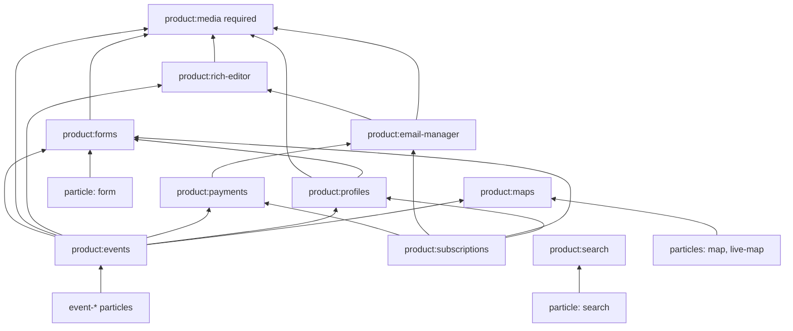
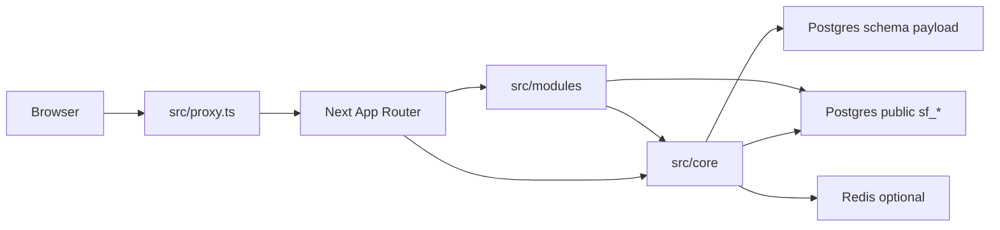

# Starforge architecture map — Phase 1 (discovery)

**Date:** 2026-11-14  
**Method:** read-only inspection of this checkout. Findings are from source (`package.json`, manifests, schema, boot files). Planning docs were used only as a cross-check. Where a doc and the code disagree, the code is what this map records.  
**Scope:** what is implemented. Planned packs (Ads, Shop, Social, Chat, Stream, ASN domain) are listed only when a stub or placeholder actually exists.

This is a discovery map, not an audit of defects.

---

## 1. Repository overview

Starforge is a single Next.js application: a product host (Core) plus toggleable packs, with Payload CMS 3 as the editorial content store. It is not a multi-package workspace. Two optional packs are local `file:` npm packages; every other engine lives under `src/modules`.

| Item | Actual |
| --- | --- |
| App | `starforge` `0.1.0`, `"type": "module"`, private |
| Runtime | Node `^22.23.4 \|\| >=24.22.1` |
| Web | Next.js `16.4.2`, React `19.2.0`, next-intl `4.14.9` |
| CMS | Payload `3.92.1` (`@payloadcms/next`, `db-postgres`, `richtext-lexical`, `storage-s3`, `ui`) |
| Auth | `better-auth` `1.7.14` + `@better-auth/drizzle-adapter` |
| Data | `drizzle-orm` `0.44.5` / `drizzle-kit` `0.31.4` on `pg` `8.16.3`; Postgres 16 via `docker-compose.yml` |
| Cache / jobs bus | `ioredis` `5.11.1` (optional; Redis service is a Compose profile) |
| Mail | `nodemailer` (SMTP). Resend and console adapters exist in Core. |
| Editors | TipTap `3.33` (`product:rich-editor`). Lexical stays as an optional pack. |
| Maps | Leaflet `1.9.4` |
| PWA | `@serwist/next` `9.5.13` |
| Validation | Zod `4.6.7` |
| Styling | Tailwind CSS `4.3.3` |
| Images | `sharp` `0.34.2` |
| List drag | `@dnd-kit/*` — nav item order and event tier order only |

### Top-level layout

| Path | Role |
| --- | --- |
| `src/app` | Next.js App Router: public site, Core admin, Payload admin, route handlers |
| `src/core` | Host, ports, Drizzle client, auth, ACL, layout/nav/chrome |
| `src/modules` | Product packs and their manifests |
| `src/generated` | Codegen output (`module-registry.ts`, `module-registry.server.ts`) |
| `src/collections`, `src/globals`, `src/payload.config.ts`, `src/migrations` | Payload collections, Site Settings global, Payload migrations |
| `src/core/db/migrations` | Drizzle migrations `0000_baseline` … `0040_event_series` |
| `src/proxy.ts` | Next 16 request proxy (locale, offline, CSP, module proxy hooks) |
| `src/instrumentation.ts` | Node boot: env assert, then module job/hook registration |
| `src/seed.ts` | Sample content / bootstrap users |
| `packages/module-consent`, `packages/module-notice-bar` | The only extractable `@starforge/module-*` packages |
| `apps/asn-capacitor` | Documented Capacitor shell for TacMap GPS. Not a running Hero domain. |
| `starforge.modules.json` | Install allowlist. Active flavor is `"core"` (`presets.core`) |
| `docker/postgres/init.sql` | `CREATE SCHEMA payload` |
| `docs/project-context/docs` | Design history. Live queue doc is `architecture-current.md` (dated 2026-11-10 in that file) |

There is no `src/hero` tree and no second brand skin. The only skin pack on disk is `src/core/skin/skins/starforge-pastel`.

---

## 2. How the four layers exist in this repo

The intended split is: **Core** (host, not a `requires` id), **base modules** (engines other packs `require`; a base pack may require another base pack), **advanced modules** (domain products whose `requires` names those engines), **Hero** (one site’s theme and vertical rules).

What the checkout actually contains:

| Layer | Present? | Where |
| --- | --- | --- |
| Core | Yes | `src/core`, plus host catalog rows in `src/core/modules/host-manifests.ts` |
| Base modules | Yes, and they depend on each other | `src/modules/{media,forms,rich-editor,email-manager,payments,profiles,maps}` |
| Advanced modules | Two real products, one stub | Events and Subscriptions are implemented. Marketplace is a dashboard card only. |
| Hero | Not built | Extension slot is `sf_profiles.extensions` jsonb. ASN Capacitor is a README plus package scaffold. |

“Base = depends only on Core” is not how the code is wired. Forms, the rich editor, Email Manager, Payments, and Profiles each `require` other base packs. Maps is the only base pack with an empty `requires` list.

Several capabilities that the layer docs call Core are still registered with `kind: 'product'` or `kind: 'platform'` so Site Settings can toggle them. Their code is Core, not `src/modules`.

---

## 3. Module inventory and classification

Registry source: `src/modules/manifest-index.ts` (host manifests + pack manifests). Allowlist for this tree: `starforge.modules.json` → `presets.core`. Runtime on/off is a separate Payload Site Settings toggle and does not remove code.

### 3.1 Core host (code in `src/core`, catalogued as modules)

These ids are not packs under `src/modules`. They are rows in `host-manifests.ts`.

| Id | Kind | What the code does |
| --- | --- | --- |
| `platform:dashboard` | platform, `required: true` | `/admin` home. Widgets: attention rail, user metrics, latest users, host pulse, system health, Chrome posture, module summary, security, performance. |
| `platform:better-auth` | platform, `required: true` | Catalog entry for Core auth. Implementation is `src/core/auth`, not a module folder. |
| `platform:payload-cms` | platform, default on | Catalog entry for `/cms/admin`. Payload itself is always compiled in (`withPayload`). |
| `product:layout-manager` | product, default on | Layout canvas, outlines, skins. Code: `src/core/modules`, `src/core/skin`. |
| `product:page-settings` | product, default on | Head / assets / body / atoms. Code: `src/core/page-settings`. Table: `sf_page_chrome`. |
| `product:primary-nav` | product, default on | Nav manager. Code: `src/core/nav`. Table: `sf_nav_menus`. |
| `product:font-awesome` | product, default on | Optional Font Awesome CDN emit from Page Settings. |
| `product:registration` | product, default on, flag `registration` | `/register` gate. |
| `product:draft-preview` | product, **default off**, flag `draftPreview` | `/preview/{slug}` for CMS-access users. |
| `product:posts` | product, **default off**, flag `posts` | Description in the manifest: “placeholder — keep off until that slice ships.” No posts collection, schema, or admin route. |

Builtin particles (Core renderers, `builtin`): `page-content`, `site-header`, `logo`, `menu`, `locale-switcher`, `copyright`, `spacer`, `social`, `custom`, `account-menu`, `login`.

Builtin atoms: `atom:analytics`, `atom:custom-css-js`.

### 3.2 Base modules (implemented engines)

| Id | Version in manifest | `requires` | Implementation (verified) |
| --- | --- | --- | --- |
| `product:media` | 0.3.0, **`required: true`** | none | Admin library + settings under `/admin/media` (generated shims). Picker: `@/modules/media/api`. Blobs and sharp pipeline stay in `src/core/media` and the Payload `media` collection. Owner ledger: `sf_media_owners`. Settings row: `sf_media_settings` (Core schema). |
| `product:forms` | 0.1.0 | `product:media` | Builder, presets, submissions, Form particle binding. Tables `sf_forms`, `sf_form_submissions`, `sf_form_settings` are declared in **`src/core/db/schema.ts`**, not `src/modules/forms/schema.ts`. Admin pages are **hand-written** at `src/app/(frontend)/admin/forms/**` (no `admin.routes` on the manifest). |
| `product:rich-editor` | 0.2.0, flag `richEditor` | `product:media` | TipTap + sanitize. Settings page only (no sidebar group). Callers pass `MediaPicker`. Root and Payload layouts import `rich-editor-chrome.css` directly. |
| `product:email-manager` | 0.1.0 | `product:rich-editor`, `product:media` | Rules, templates, send log, broadcasts. Tables `sf_email_templates`, `sf_email_rules`, `sf_email_sends`, `sf_email_broadcasts`, `sf_email_broadcast_recipients`. Transport is Core `getMailer()`. |
| `product:payments` | 0.1.0 | `product:email-manager` | Cart, checkout, orders, invoices, coupons, merchants, encrypted merchant credentials, fiscal outbox, invoice sequences, recurring rows, frozen `sf_pay_collect_entitlements`. Gateway/fiscal/billing adapters are Core (`src/core/payments`: manual, Barion, Stripe, PayPal, NAV, Billingo, Számlázz, plus noop). Fulfillment is `registerPaymentConsumerHook`. |
| `product:profiles` | 0.1.0 | `product:media`, `product:forms` | One persona per user (`sf_profiles`, PK = `sf_users.id`), `/u/[handle]`, account editor, `getPersonas()`, `extensions` jsonb. |
| `product:maps` | 0.2.1 (“TacMap”) | `[]` | Rooms, teams, sessions, positions, overlays (`sf_map_*`). Leaflet + OSM via Core `MapProvider`. Live ingest/join/leave under `/api/maps/live/...`. |

### 3.3 Advanced modules

| Id | `requires` | What exists |
| --- | --- | --- |
| `product:events` | forms, media, rich-editor, payments, profiles, maps | Venues, categories, events (including series fields), parties, ticket tiers, registrations, check-in, public `/events`, registration forms, payment hook `events.confirmRegistration`. Admin is generated shims. Particles: `event-list`, `event-upcoming`, `event-calendar`, `event-featured`, `event-mini-calendar`, `event-detail`, `event-countdown` (each `requires: ['product:events']`). |
| `product:subscriptions` | payments, email-manager, forms, profiles | Plans, periods, seats (`sf_sub_plans`, `sf_sub_periods`, `sf_sub_seats`). Account page, admin plans/subscribers/settings. Registers a payment hook and an expiry job from `instrumentation.ts`. |
| `product:marketplace` | none | **Stub.** Manifest `0.0.1`. Dashboard widget `marketplace.listings` only. README states no schema, routes, or admin UI. `defaultEnabled: true` and it is on the core allowlist. |

No Ads, Shop, Support, Stream, Social, or Chat module folders exist.

### 3.4 Site packs (optional; not Core and not a domain product)

| Id | Notes |
| --- | --- |
| `product:redirects` | `sf_redirects`, admin CRUD + CSV, proxy hook `handleRedirectProxy` (order 10). Sitemap stays Core. |
| `product:consent` | Banner via `publicShell` `bodyEnd`. Package `@starforge/module-consent` plus `src/modules/consent`. |
| `product:pwa` | **Default off.** Manifest + Serwist registration. Admin `/admin/pwa`. |
| `product:search` | Public `/search` and a `search` particle (`requires: ['product:search']`). Query engine is Core: `src/core/content/search.ts` over `PageReadsPort`. |
| `product:lexical-editor` | **Default off.** Settings page only. Payload config comment: page body is TipTap HTML, not a root Lexical editor. |
| `notice-bar` | Particle, **default off**, `importPath` `@/modules/notice-bar`. Package `@starforge/module-notice-bar`. |
| `form` | Particle, `requires: ['product:forms']`. |
| `map`, `live-map` | Particles, `requires: ['product:maps']`. |

### 3.5 Hero

Not present as a layer.

- Skin: `starforge-pastel` inside the Core skin port (default, offline, not-found outlines).
- `apps/asn-capacitor`: WebView shell description. It does not contain domain tables or a theme.
- Profiles `extensions` jsonb is the documented place for a later vertical. No ASN columns on `sf_events_*` or `sf_pay_*` were found as a Hero pack.

---

## 4. Module dependency diagram

### 4.1 Declared `requires` (install and toggle closure)

`closeModuleRequires` / `resolveModuleToggleRequires` in `src/core/modules/requires-graph.ts` walk these edges. Enabling a module turns its transitive `requires` on. Turning a dependency off fails while a still-enabled module needs it.



Particles and site packs with no `requires` (redirects, consent, pwa, lexical, notice-bar, search product, marketplace stub) are omitted from the diagram. They do not pull the graph above.

Transitive closure examples from the manifests:

- Payments ⇒ email-manager ⇒ rich-editor + media.
- Subscriptions ⇒ payments, email-manager, forms, profiles ⇒ media + rich-editor.
- Events ⇒ all of the base engines in the diagram, including maps.

### 4.2 Imports that are not on `requires`

These are real `from '@/modules/...'` edges. They are not closed by the installer graph.

| From | To | Evidence |
| --- | --- | --- |
| `src/instrumentation.ts` | events `abandoned-checkout`, subscriptions `api`, email-manager `api.server` | Direct `import()` at Node boot. Failures for subscriptions and email are swallowed. Events sweep is not in a try/catch. |
| `src/core/mail/with-send-log.ts` | email-manager `send-log` | Dynamic import; missing pack is ignored. |
| `src/app/(frontend)/layout.tsx` and `src/app/(payload)/layout.tsx` | rich-editor CSS | Static import, not allowlist-gated. |
| `src/modules/maps/admin/*` | `src/modules/events/store` | TacMap room screens load events. Maps declares `requires: []`. This is a base screen reading an advanced pack. |
| `src/modules/profiles/components/ProfileEditor.tsx` | `src/modules/maps/VenueLocationMap` | Profiles does not `require` maps. |
| `src/app/(frontend)/admin/forms/page.tsx` | events `registration-form`, profiles `profile-form` | Forms list page seeds those definitions. |
| `src/app/(frontend)/admin/layouts/*`, breakpoints panels | `MediaPicker`, forms config | Core admin screens import module APIs. `src/core/**` itself has **no** `@/modules` imports. |

`src/core/**` staying free of static module imports is true. The Next boot file and the root layouts are outside that folder and do import modules.

---

## 5. Core architecture

### 5.1 Boot

1. `next.config.ts` wraps the config with `withSerwist` → `withPayload` → `withNextIntl`. Serwist and Payload are compile-time wrappers, not allowlist checks. Serwist is `disable`d when `NODE_ENV === 'development'` and `register: false` (the PWA module owns registration).
2. `src/instrumentation.ts` `register()` skips the Edge runtime. On Node it calls `assertStarforgeEnvAtBoot()`, then `ensureAbandonedCheckoutSweep()` (events), then subscriptions payment hook + expiry job, then email broadcast drain. The last two are try/caught.
3. `src/proxy.ts` runs next-intl (locales from Site Chrome, fail-open to bootstrap `en`/`hu`), offline gate, security headers, and `runProxyHooks()` from the generated server registry (redirects).
4. Drizzle pool is created lazily in `src/core/db/index.ts` from `DATABASE_URL` (default local `starforge:starforge@127.0.0.1:5432/starforge`).

`predev` and `prebuild` run `modules:generate`.

### 5.2 Core areas (directories that exist)

`acl`, `admin-nav`, `admin-theme`, `audit`, `auth`, `cms-bridge`, `consent`, `content` (pages, search, sitemap, cache, `page-reads`), `dashboard`, `db`, `env`, `env-editor`, `i18n`, `jobs`, `localization`, `mail`, `maps` (MapProvider), `media` (storage, pipeline, analysis), `modules` (layout host + manifest types), `nav`, `page-settings`, `payments` (adapters), `realtime`, `redis`, `security` (CSP, cookies, rate limit, captcha), `settings`, `site-chrome`, `skin`.

Public barrel: `src/core/index.ts`. It re-exports host APIs and a subset of Drizzle tables. It does not re-export module tables.

### 5.3 Ports that exist in code

| Port | Location | Adapter actually constructed |
| --- | --- | --- |
| Mailer | `src/core/mail` | disabled / console / SMTP / Resend, from Site Chrome. Sends are soft-logged via Email Manager when that import works. |
| Published content cache | `src/core/content/cache` | Next `unstable_cache` by default. Redis when `STARFORGE_CONTENT_CACHE=redis` and `REDIS_URL`. |
| MediaStorage | `src/core/media` + Payload S3 plugin | Local disk, or S3/Spaces when `STARFORGE_MEDIA_STORAGE=s3`. |
| MediaAnalysisPort | `src/core/media/analysis` | **Noop only.** `getMediaAnalysisPort()` always returns `createNoopMediaAnalysisPort()`. Media admin has an explicit Analyze action. No vendor adapter. |
| MapProvider | `src/core/maps` | `leaflet-osm` (env `STARFORGE_MAP_PROVIDER`). |
| Payments / fiscal / billing | `src/core/payments` | Provider factories listed in §3.2. Secrets: site-wide in env; per-merchant ciphertext in `sf_pay_merchant_credentials`. |
| PageReadsPort | `src/core/content/page-reads` | Payload adapter only: published slug, draft, search list, sitemap summaries. |
| RealtimePort | `src/core/realtime` | In-memory bus; Redis fanout when configured. HTTP: `/api/realtime`. |
| RateLimiter | `src/core/security/rate-limit` | In-memory. Better Auth uses Redis rate limit only when `REDIS_URL` is set. |
| Captcha | `src/core/security/captcha` | Turnstile is the wired provider. Policy lives with Site Chrome. |
| JobRunner | `src/core/jobs` | In-process memory. Comment in `index.ts`: Redis adapter is not built. Callers must not assume cross-process delivery. |
| Skin / admin theme | `src/core/skin`, `src/core/admin-theme` | `starforge-pastel` public skin; Gantry admin CSS (`core-chrome.css`, `payload-chrome.css`). |

**Not in source:** `LlmProvider`. A search of `src/**/*.ts(x)` finds no symbol.

`PageReadsPort`’s own file lists remaining direct `getPayload()` callers: `src/core/media/*`, `src/core/settings`, `src/core/nav/store.ts`, `src/core/cms-bridge/*`, `src/app/api/cms/exchange/route.ts`, `src/seed.ts`. Media bytes and Site Settings are not behind that port.

### 5.4 Layout host

One canvas: `src/app/(frontend)/admin/canvas/section-row-canvas.tsx`. The Form builder uses that canvas. Width math is `src/core/modules/grid.ts`. Empty-row ids are `src/core/modules/empty-row-id.ts`. Documents live in `sf_layouts` (JSON). `@dnd-kit` is used for nav items and event tiers, not for this canvas.

Particles register through manifests. Codegen emits loaders. Builtin particles render from `src/core/modules/particles`. Optional particles use dynamic `import()`.

---

## 6. Database and Payload

One Postgres database, two schemas (`docker/postgres/init.sql` creates `payload`; Drizzle is filtered to `public`).

### 6.1 Two migration pipelines

| Pipeline | Command | Directory |
| --- | --- | --- |
| Core + module `sf_*` | `db:core:migrate` (drizzle-kit). `db:migrate` runs this, then Payload. | `src/core/db/migrations` (`0000`–`0040`) |
| Payload | `payload:migrate` | `src/migrations` |

`drizzle.config.ts` schema glob:

```ts
schema: ['./src/core/db/schema.ts', './src/modules/*/schema.ts']
schemaFilter: ['public']
```

The **runtime** Drizzle client does not use that glob. `src/core/db/index.ts` does `import * as schema from './schema'` (Core file only) and `drizzle(pool, { schema })`. Module stores import their own `pgTable` objects and call `db.insert/select` with those objects. Relational `db.query.*` is only typed for Core tables.

### 6.2 `public` tables in Core schema (`src/core/db/schema.ts`)

Auth: `sf_users`, `sf_sessions`, `sf_accounts`, `sf_verifications`, `sf_two_factors`.

Host: `sf_layouts`, `sf_page_chrome`, `sf_site_chrome`, `sf_nav_menus`, `sf_user_groups`, `sf_user_group_members`, `sf_acl_permissions`, `sf_module_settings`, `sf_admin_audit`.

Forms and media settings, physically in the Core file: `sf_forms`, `sf_form_submissions`, `sf_form_settings`, `sf_media_settings`.

`sf_users` holds app role and `cms_access`. Groups have `parent_id` (migration `0039`).

### 6.3 `public` tables in module `schema.ts` files

| Module | Tables |
| --- | --- |
| redirects | `sf_redirects` |
| media | `sf_media_owners` |
| profiles | `sf_profiles` (FK → `sf_users`, `extensions` jsonb) |
| email-manager | `sf_email_templates`, `sf_email_rules`, `sf_email_sends`, `sf_email_broadcasts`, `sf_email_broadcast_recipients` |
| maps | `sf_map_rooms`, `sf_map_room_admins`, `sf_map_teams`, `sf_map_team_members`, `sf_map_sessions`, `sf_map_positions`, `sf_map_overlays` |
| payments | `sf_pay_settings`, `sf_pay_carts`, `sf_pay_cart_lines`, `sf_pay_merchants`, `sf_pay_merchant_credentials`, `sf_pay_collect_entitlements`, `sf_pay_orders`, `sf_pay_order_lines`, `sf_pay_intents`, `sf_pay_invoices`, `sf_pay_invoice_lines`, `sf_pay_fiscal_outbox`, `sf_pay_invoice_sequences`, `sf_pay_coupons`, `sf_pay_coupon_redemptions`, `sf_pay_recurring` |
| events | `sf_venues`, `sf_event_categories`, `sf_events` (series id + pattern), `sf_event_parties`, `sf_event_ticket_tiers`, `sf_event_registrations` |
| subscriptions | `sf_sub_plans`, `sf_sub_periods`, `sf_sub_seats` |

Marketplace has no schema file.

### 6.4 Payload (`schemaName: 'payload'`)

`src/payload.config.ts`:

- Admin route: `/cms/admin`.
- Collections: `users`, `media`, `pages`, `tags`, `categories`.
- Global: `site-settings` (module/feature toggles, `primaryNavMenuId`, `siteName`). Editors can read; update is Core-admin (`isCoreAdmin`).
- Localization: codes from `src/core/i18n/locales` (`en`, `hu` bootstrap). Admin-added public locales do not hot-reload into this config; the file says a restart is required.
- Push is off unless `STARFORGE_PAYLOAD_PUSH=1`.
- Storage plugins come from the Core MediaStorage port.
- No root Lexical editor.

Payload `users` are CMS stubs: `coreUserId` (unique), local create/update/delete access denied, custom auth strategy `starforge-core-session`. Local strategy stays enabled because Payload’s JWT cookie exchange requires it. The login view is replaced by a redirect to Core login.

Site policy (offline, metadata, robots, cookies, mail provider, captcha, locale catalog) is **not** the Payload global. It is `sf_site_chrome` JSON, edited at `/admin/site-chrome`. Localization settings are fields on that Chrome document (`src/core/localization/store.ts`).

Content-locale strings for layout/nav/chrome live as JSON files under `data/content-locales/{locale}/`, not as extra Postgres tables.

---

## 7. Authentication and authorization

### 7.1 Better Auth (product login)

`src/core/auth/index.ts` builds one `betterAuth` instance:

- Drizzle adapter on `sf_users`, `sf_sessions`, `sf_accounts`, `sf_verifications`, `sf_two_factors`.
- Email + password (reset mail), email verification, magic link, email OTP, TOTP two-factor, user deletion.
- Admin plugin roles: `admin` | `member` (`src/core/auth/permissions.ts`). Legacy role `user` normalizes to `member`.
- Google OAuth only when both `GOOGLE_CLIENT_ID` and `GOOGLE_CLIENT_SECRET` are set.
- If `REDIS_URL` is set: Redis `secondaryStorage` plus Better Auth rate limit. Sessions stay in Postgres (`storeSessionInDatabase: true`) and are mirrored.
- Mail goes through Core auth mail helpers → Mailer port.
- HTTP: `src/app/api/auth/[...all]/route.ts`. Session JSON: `GET /api/me`.

### 7.2 Two session cookies

| Cookie | Use |
| --- | --- |
| `better-auth.session_token` (or `__Secure-` variant) | Public / member site |
| `sf-admin.session_token` (or `__Secure-` variant) | Staff backend. Minted for Core admin. Payload’s strategy reads **this** cookie, not the public one, so a public sign-out does not drop CMS by itself. |

Cookie `Secure` follows `BETTER_AUTH_URL` / `NEXT_PUBLIC_APP_URL` https, or `STARFORGE_SECURE_COOKIES`.

### 7.3 Who may open what

| Mechanism | Behavior in code |
| --- | --- |
| App role `admin` | Bypasses the ACL matrix. Opens Core admin. |
| App role `member` | Core admin only where a group grant exists. |
| Groups | `sf_user_groups` + `sf_user_group_members`. Nested via `parent_id`. |
| ACL matrix | `sf_acl_permissions` keyed by group + resource. Decision helpers: `src/core/acl/decide.ts`. Enforced by admin path gates. |
| `cms_access` on `sf_users` | Links a Payload user stub and allows `/cms/admin` through the Better Auth strategy. Payload passwords are not the login. |
| Developer-admin | `STARFORGE_DEVELOPER_ADMIN_EMAILS`. Empty list: all app admins outside production; nobody in production. Used for Environment editor, audit read, and script-capable page fields. |
| Nav / particle / chrome visibility | Tags `public`, `registered`, `group:<id>`. Empty tag list is public. Separate from the admin ACL matrix. |

ACL resource keys (`src/core/acl/types.ts`): dashboard, users, groups, settings, site-chrome, localization, environment, nav, forms, email-manager, payments, payments-merchant, subscriptions, events, profiles, maps, redirects, layouts, page-settings, cms.

`/admin/media` and `/admin/audit` are hard-coded `app-admin` (no matrix row). Any other unmatched `/admin` path, including `/admin/pwa`, also falls through to app-admin only.

### 7.4 CMS bridge

`src/core/cms-bridge/payload-strategy.ts`: if the staff admin cookie is present and the Origin is trusted, resolve the Better Auth session and find the Payload user by `coreUserId`, then by email. `/api/cms/exchange` issues the Payload JWT (`payload-token`) for the admin UI. Payload login form is replaced (`AdminLoginRedirect`, `KillPayloadLoginForm`).

---

## 8. Next.js frontend and backend

App Router. Route groups do not appear in the URL.

| Tree | Role |
| --- | --- |
| `src/app/(frontend)/layout.tsx` | Root HTML. Imports public skin CSS and rich-editor chrome CSS. |
| `src/app/(frontend)/(public)/[locale]/` | Locale-prefixed public site: home, `[slug]`, preview, search, login/register/recovery/2FA, account (security, profile, events, subscriptions), events, checkout, `/u/[handle]`. |
| `src/app/(frontend)/admin/` | Core admin, hand-written: dashboard, users/groups/ACL, site chrome, environment, settings topics, nav, layouts/outlines/skins/breakpoints, page settings, localization, audit, **forms**. |
| `src/app/(frontend)/admin/(modules)/` | Generated re-exports (`export { default } from '@/modules/...'`). Media, email, payments, subscriptions, events, profiles, maps, redirects, pwa, rich-editor settings, lexical settings. Marker comment: do not edit by hand. |
| `src/app/(payload)/` | Payload root layout + `/cms/admin/[[...segments]]`. Themed with Core payload chrome CSS. |
| `src/app/api/` | Auth, health, me, media file, redirects lookup, payments webhooks, maps live, realtime, account download, form/event exports, CMS exchange, CSP sources, admin session, offline gate. |

Public pages are under `[locale]` with `localePrefix: 'always'`. Core admin is **not** locale-prefixed (`/admin`). Payload admin is `/cms/admin`.

`next.config.ts` redirects keep old paths working: `/app/admin` → `/admin`, and old Payload collection/global URLs that used to sit under `/admin` → `/cms/admin/...`. `/admin/login` stays Core staff sign-in.

Security headers are set in `headers()` and re-applied in `src/proxy.ts` with feature CSP sources.

There is no separate “backend service.” Server Actions, route handlers, and Payload Local API share this Node process and this database.

---

## 9. Module registration, dependencies, and build

Three different switches. They are not the same thing.

| Switch | Mechanism | Effect in this repo |
| --- | --- | --- |
| Install allowlist | `starforge.modules.json` (`flavor: "core"` → `presets.core`), or `SF_MODULES` | `scripts/generate-module-registry.mts` reads `ALL_MODULE_MANIFESTS`, runs `closeModuleRequires`, writes `src/generated/module-registry.ts` and `.server.ts`, and rewrites admin shims under `admin/(modules)/`. Omitted ids lose generated loaders. |
| Package sync | `npm run modules:sync`, `modules:wizard` | Aligns `@starforge/module-*` dependencies. `registryPackages` lists only `notice-bar` and `product:consent`. Every other pack is source inside this repo, so sync cannot omit it from disk. |
| Runtime toggle | Payload global `site-settings`, Site Settings → Modules | Hides nav/palette/public render for an installed id. `requires` closure runs on save (`resolveModuleToggleRequires`). Does not delete code. `product:media` is `required: true`. `platform:better-auth` and `page-content` are forced by codegen docs. |

Manifest contract: `defineStarforgeModule` in `src/core/modules/define-module.ts`. A pack contributes metadata plus string import paths (admin routes, dashboard widgets, proxy hooks, public shell, particles). Codegen emits `import()` from those strings. It does not execute pack code while generating.

Adding a pack today means: `src/modules/<id>/manifest.ts`, register it in `manifest-index.ts`, add the id to `starforge.modules.json`, run `modules:generate`. Optional UI strings: `messages/<locale>.json` plus `i18n.namespaces`.

`npm run db:migrate` (`scripts/db-migrate.mts`) applies Drizzle then Payload. `npm run build` is `next build` after codegen (Node heap raised to 8000). Unit tests are `node:test` via `tsx --test` (not a separate test runner). Many `verify:*` scripts are source-shape checks.

TypeScript path `@/*` → `./src/*`. Consent and notice-bar also have explicit paths into `packages/`. `transpilePackages` lists those two.

---

## 10. Request / data sketch



Anonymous page HTML is supposed to read published pages through `PageReadsPort` and the content cache, not ad-hoc Payload calls. Media library, Site Settings, and the CMS session bridge still call Payload directly.

Checkout money moves through `product:payments`. Events and Subscriptions register fulfillment hooks; Payments stores `sourceModule` and line snapshots and does not own ticket capacity or plan periods.

---

## 11. Unclear or undocumented areas

These are gaps between the layer story, the docs, and the code. They are observations, not proposed fixes.

1. **Catalog ids vs folders.** `product:layout-manager`, `product:page-settings`, `product:primary-nav`, `product:font-awesome`, `product:registration`, `product:posts`, and `product:draft-preview` are Core features with product ids. `product:posts` is a flag with no implementation. Calling them modules in Site Settings does not make them packs.

2. **Split ownership inside Forms, Media, and Search.** Forms tables and media settings live in the Core Drizzle file. Search query lives in `src/core/content`. The admin/catalog ids live in `src/modules`. A reader cannot treat `src/modules/<id>/schema.ts` as the full table list.

3. **Runtime Drizzle schema is Core-only.** Kit generates migrations from module schemas; the `drizzle()` schema bag does not include them. That works for `db.select().from(table)` and is easy to miss.

4. **Boot reaches into modules.** `src/instrumentation.ts` imports Events, Subscriptions, and Email Manager by path. That is outside the generated registry. Events sweep is unconditional. Docs that say Core imports `@/generated/*` only do not describe this file.

5. **Declared graph vs imports.** Maps admin depends on Events. Profiles editor depends on Maps. Neither edge is a `requires` entry. Install closure will not pull Events because Maps is enabled.

6. **Forms admin is not a generated route.** Other packs use `admin.routes` shims. Forms pages are maintained under `src/app/(frontend)/admin/forms` and that list page imports Events and Profiles seeders.

7. **Payload and Serwist are not optional in the build.** `withPayload` and `withSerwist` always wrap Next. Site Settings can hide CMS nav; it does not remove Payload from the bundle. PWA defaults off, but the service-worker build config is always present (disabled in development).

8. **MediaAnalysisPort vs the live architecture doc.** `docs/project-context/docs/architecture-current.md` says this port is still paper and that stubs should not exist without a consumer. The code has a noop port, and Media admin calls it. `LlmProvider` matches the “paper” description: it is absent.

9. **Job runner is single-process.** Redis is used for content cache, Better Auth secondary storage, and realtime fanout. `getJobRunner()` is still the memory adapter. Subscriptions expiry and email broadcasts register on that runner. Multi-instance behavior of those jobs is not implemented.

10. **ACL holes by design in code, easy to miss.** Media, audit, and PWA have no matrix keys. Unlisted admin paths are app-admin only (`adminAreaGateForPath` default).

11. **Marketplace is installed and default-on as a stub.** The core flavor allowlist includes `product:marketplace`. There is no listings table.

12. **Hero is a rule, not a directory.** No theme pack besides `starforge-pastel`. No ASN currency, milsim, or fee tables. `apps/asn-capacitor` documents a future native bridge; it is not wired into module registration.

13. **Payload locales vs public locales.** Public routing reads the Chrome locale catalog. Payload’s `localization.locales` is the code bootstrap list. The config comment states admin-added locales need a code change and a restart before CMS fields know them.

14. **Doc freshness.** `architecture-current.md` says “live map as of 2026-11-10” and still describes the next product pack as ads, with paid tickets and subscriptions lifecycle already shipped. This checkout matches “Events and Subscriptions exist.” It also contains later schema (event series `0040`, group parent `0039`) that that page does not inventory. Treat that page as queue policy, not as a file-level map.

---

## 12. Source files this map is anchored to

- `package.json`, `next.config.ts`, `drizzle.config.ts`, `tsconfig.json`, `starforge.modules.json`, `docker-compose.yml`, `docker/postgres/init.sql`
- `src/payload.config.ts`, `src/collections/Users.ts`, `src/globals/SiteSettings.ts`
- `src/instrumentation.ts`, `src/proxy.ts`, `src/core/index.ts`, `src/core/db/schema.ts`, `src/core/db/index.ts`
- `src/core/modules/define-module.ts`, `host-manifests.ts`, `requires-graph.ts`
- `src/modules/manifest-index.ts` and each `src/modules/*/manifest.ts`
- `src/modules/*/schema.ts` (redirects, media, profiles, email-manager, maps, payments, events, subscriptions)
- `src/core/auth/index.ts`, `permissions.ts`, `admin-session.ts`, `src/core/cms-bridge/payload-strategy.ts`, `src/core/acl/types.ts`, `decide.ts`
- `src/generated/README.md`, `scripts/generate-module-registry.mts`
